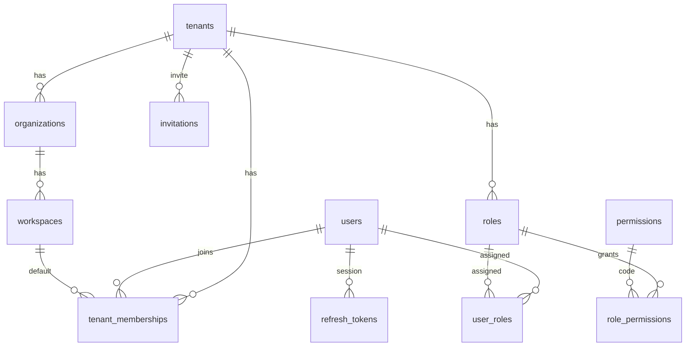
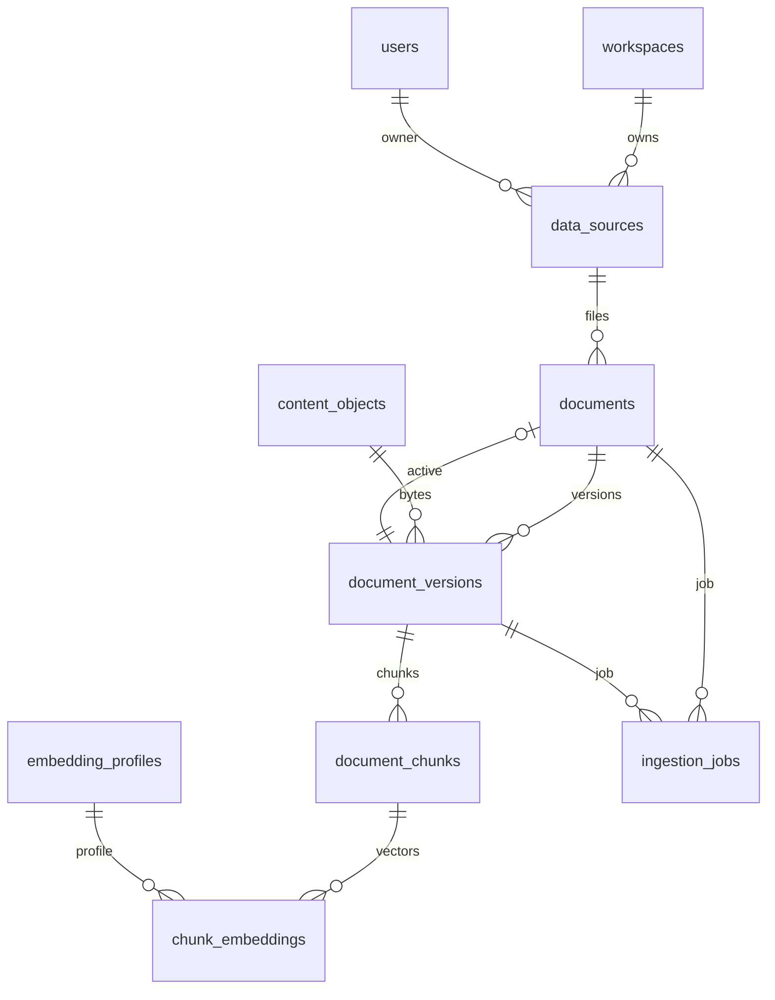
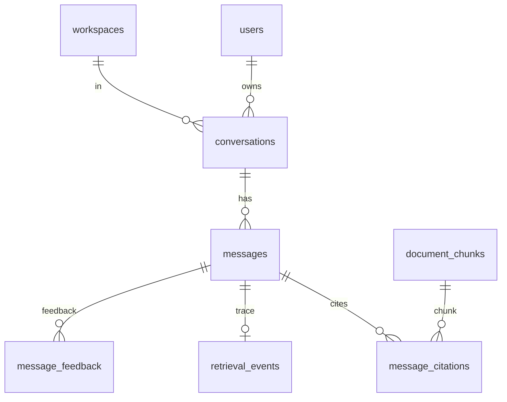
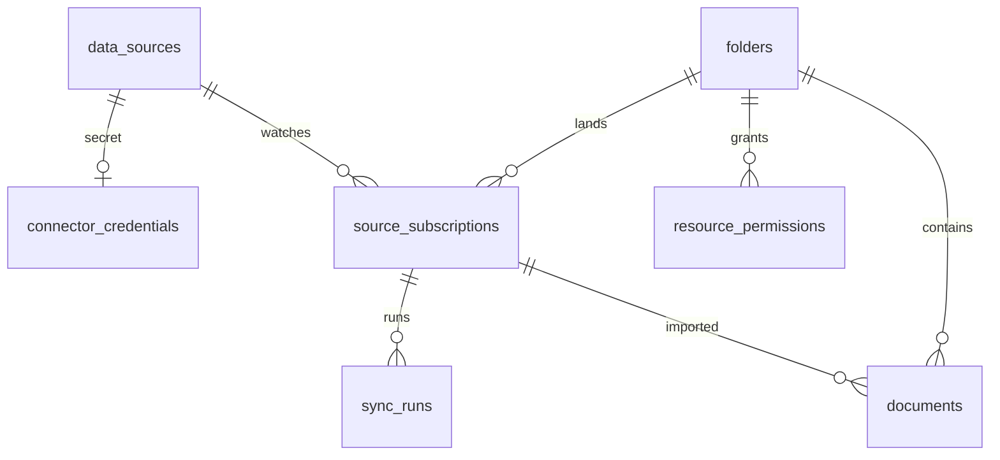

# Database design

Source of truth: Alembic revisions `001_initial_schema` through `009_document_visibility_defaults`, and SQLAlchemy models in `backend/app/adapters/db/models.py`. Where a model column was added in a later migration, both are cited.

Engine: PostgreSQL. Extensions created in `001`: `vector`, `citext`. Schema `app_security` holds `current_tenant_id()`.

Primary keys are UUID, default `gen_random_uuid()` in SQL and `uuid4` on the ORM (`UUIDPrimaryKeyMixin`). There is no soft-delete column. External removal sets `documents.external_status = 'deleted_externally'`. Refresh tokens use `revoked_at`. Invitations use `accepted_at`.

`TimestampMixin` provides `created_at` and `updated_at` (`timestamptz`, server default `now()`). `updated_at` `onupdate` is an ORM behavior, not a database trigger.

## Migration history

| Revision | File | What it changes |
| --- | --- | --- |
| `001_initial_schema` | `001_initial_schema.py` | Core tables, GIN on `search_vector`, RLS on `TENANT_TABLES`, permission seed |
| `002_auth_refresh` | `002_auth_refresh.py` | `refresh_tokens`; adjusts `tenant_memberships` policy |
| `003_connectors` | `003_connectors.py` | OAuth state, credentials, subscriptions, sync runs, RLS |
| `004_content_address` | `004_content_address.py` | `content_objects`, version hash columns, indexes |
| `005_oauth_state_source` | `005_oauth_state_source.py` | `oauth_states.source_id` |
| `006_owner_acl` | `006_owner_acl.py` | Owner columns / ACL backfill and owner indexes |
| `007_saas_platform` | `007_saas_platform.py` | Super admin, invitations, folders, resource permissions, audit policy, new permission codes |
| `008_authz_epoch` | `008_authz_epoch.py` | `tenants.authz_epoch`, `users.authz_epoch`, `rate_limit_buckets` |
| `009_document_visibility_defaults` | `009_document_visibility_defaults.py` | Delete `document:read_all` from Tenant Admin and Admin; set admin-owned private docs to `visibility=tenant`; bump epochs |

`009` down-revision is `008_authz_epoch`. Head of the chain in this tree is `009`.

## RLS

For each table in migration `001` `TENANT_TABLES`:

- Index `ix_{table}_tenant_id` on `tenant_id` (some tables also have a stronger index).
- `ENABLE ROW LEVEL SECURITY` and `FORCE ROW LEVEL SECURITY`.
- Policy `tenant_isolation`: `USING (tenant_id = app_security.current_tenant_id())` and the same `WITH CHECK`.

`current_tenant_id()` is `NULLIF(current_setting('app.tenant_id', true), '')::uuid`.

Later migrations add the same pattern for connector tables, `content_objects`, `folders`, `resource_permissions`, and a dedicated `audit_logs` policy (migration `007`, including platform rows with null tenant). `refresh_tokens`, `invitations`, `users`, `permissions`, `tenants`, and `rate_limit_buckets` are not in the original tenant-policy loop. Invitations and refresh tokens are intentionally looked up by hash without tenant RLS (model comments).

Session variables are set in `apply_rls` / `apply_rls_ids` for the current transaction only.

Superuser connections bypass these policies. See [SECURITY.md](SECURITY.md).

## Transactions

HTTP handlers that take `_db` run inside `session.begin()` (`async with session.begin()`). Commit happens when the dependency exits successfully. Rollback happens on exception.

`IngestionService.process_job` uses `begin_nested()` around parse/chunk/embed/index. A failure rolls nested work back, then the outer transaction records `failed` or `dead_letter` on the job and `failed` on the version.

Upload with `queue.provider` in `{asyncio, taskiq_redis}` calls `process_job` on the **same** session before commit (`documents.py`). The client receives the post-processing job status, and document plus index commit together.

`PostgresFTSIndex.search` runs inside `begin_nested()` and returns `[]` on any exception.

Advisory lock: `pg_advisory_xact_lock(hashtext(tenant), hashtext(content_hash:fingerprint))` in `_lock_content`, held until the transaction ends.

`ingestion_jobs` unique `(tenant_id, idempotency_key)`. A concurrent insert of the same key raises `IntegrityError` from the database. `ingest_content` does not catch that error. Content-object insert uses a nested transaction and catches `IntegrityError` to re-select.

Chat streaming commits when the SSE event `generation.completed` is about to be sent (`chat.py`), so the UI can reload the message. That session is separate from the earlier authorize transaction.

## Identity and tenancy

### tenants

| Column | Type | Null | Default | Notes |
| --- | --- | --- | --- | --- |
| id | uuid | no | gen_random_uuid() | PK |
| name | varchar(255) | no | | |
| slug | varchar(128) | no | | unique |
| residency | varchar(64) | yes | | |
| status | varchar(32) | no | `active` | login requires `active` |
| privacy | jsonb | no | `{}` | |
| budget | jsonb | no | `{}` | |
| authz_epoch | integer | no | 0 | migration 008 |
| created_at, updated_at | timestamptz | no | now() | |

### organizations

PK `id`. FK `tenant_id` → tenants. Unique `(tenant_id, slug)`. `name`, `slug`.

### workspaces

PK `id`. FK `tenant_id`, `organization_id` → organizations. Unique `(tenant_id, organization_id, slug)`.

### users

PK `id`. `email` citext **unique**. `password_hash` varchar(255) nullable. `status` default `active`. `is_super_admin` boolean default false (migration 007). `display_name` text. `last_login_at` timestamptz. `authz_epoch` integer default 0 (008). Timestamps.

No RLS policy on `users` in `001`.

### tenant_memberships

PK `id`. Unique `(tenant_id, user_id)`. FK `user_id` → users, `default_workspace_id` → workspaces nullable.

### teams / team_members

`teams`: PK, `tenant_id`, `workspace_id` nullable FK, `name`. `team_members`: unique `(team_id, user_id)`, FKs to teams and users, `created_at` only (no `TimestampMixin`).

### permissions / roles / role_permissions / user_roles

- `permissions`: PK, `code` varchar(128) **unique**, `description`. Global, not tenant-scoped.
- `roles`: unique `(tenant_id, name)`, `is_system` boolean default false.
- `role_permissions`: unique `(role_id, permission_id)`, FKs to roles and permissions, `tenant_id`.
- `user_roles`: FKs user, role, optional `workspace_id`. No unique constraint in the model.

Cardinality: tenant 1—N roles; role N—N permissions; user N—N roles per tenant.

### invitations

No `TenantMixin` RLS. FK `tenant_id`, `invited_by`, `invited_user_id`. `email` citext. `token_hash` varchar(64) unique. `purpose` default `invite`. `expires_at`, `accepted_at`, `role_ids` jsonb, timestamps. Index `ix_invitations_tenant_email` `(tenant_id, email)`.

### refresh_tokens

No RLS. FK `user_id`, optional `tenant_id`. `token_hash` varchar(64) unique. `expires_at`, `revoked_at`, `created_at`. Index `ix_refresh_tokens_user_id`.

### config_overlays

Unique `(tenant_id, scope_type, scope_id)`. `payload` jsonb, `version` integer default 1.

## Documents and index

### data_sources

FK `workspace_id`, optional `owner_user_id`. `name`, `connector_type`, `connector_config` jsonb, `cursor` jsonb, `status` default `disconnected`, `last_synced_at`, `last_error`. Index `ix_data_sources_owner` `(tenant_id, owner_user_id)`, `ix_data_sources_workspace`.

### documents

Unique `(tenant_id, source_id, source_file_id)`.

| Column | Type | Null | Default | Notes |
| --- | --- | --- | --- | --- |
| id | uuid | no | | PK |
| tenant_id | uuid | no | | FK tenants |
| workspace_id | uuid | no | | FK workspaces |
| source_id | uuid | no | | FK data_sources |
| source_file_id | varchar(512) | no | | upload uses filename |
| subscription_id | uuid | yes | | FK source_subscriptions |
| folder_id | uuid | yes | | FK folders; index `ix_documents_folder` |
| path | text | no | | |
| title | varchar(512) | yes | | |
| classification | varchar(64) | no | `internal` | |
| owner_user_id | uuid | yes | | FK users; index `ix_documents_owner` |
| acl | jsonb | no | `{}` | visibility and allow/deny lists |
| external_revision | varchar(255) | yes | | |
| external_status | varchar(32) | no | `active` | also `deleted_externally` |
| active_version_id | uuid | yes | | FK document_versions `fk_documents_active_version_id` (use_alter) |
| created_at, updated_at | timestamptz | no | | |

Index `ix_documents_tenant_workspace` `(tenant_id, workspace_id)`.

Cardinality: workspace 1—N documents; source 1—N documents; document 1—N versions; document 0..1 active version.

### content_objects

Unique `(tenant_id, content_hash)`. `storage_key`, `mime_type`, `size_bytes`, `ref_count` default 1 in SQL / 0 when the service inserts before increment. RLS enabled in `004`.

### document_versions

Unique `(document_id, version_number)`.

| Column | Type | Null | Default |
| --- | --- | --- | --- |
| id | uuid | no | PK |
| tenant_id | uuid | no | |
| document_id | uuid | no | FK documents |
| version_number | integer | no | |
| checksum | varchar(128) | yes | set to content hash |
| content_hash | varchar(128) | no | added/used by 004 |
| content_object_id | uuid | yes | FK content_objects |
| derived_from_version_id | uuid | yes | FK document_versions; index in 004 |
| pipeline_fingerprint | varchar(64) | yes | |
| etag, revision | varchar | yes | |
| mime_type | varchar(255) | no | |
| storage_key | text | no | |
| size_bytes | bigint | yes | |
| parser_provider, parser_version, chunker_strategy, chunker_version | varchar | yes | |
| status | varchar(32) | no | `pending` in table; service writes `queued` |
| metadata | jsonb | no | `{}` (ORM attribute `extra_metadata`) |
| source_created_at, source_modified_at, ingested_at | timestamptz | yes | |
| created_at | timestamptz | no | now() |

Index `ix_document_versions_content_hash` `(tenant_id, content_hash, pipeline_fingerprint, status)`.

### document_chunks

Unique `(version_id, chunk_index)`. FK document, version. `text`, `page`, `section`, `token_count`, `metadata` jsonb. `search_vector tsvector GENERATED ALWAYS AS (to_tsvector('english', coalesce(text, ''))) STORED`. GIN index `ix_document_chunks_search_vector`.

### embedding_profiles

Unique `(tenant_id, provider, model, dimensions, version)`.

### chunk_embeddings

Unique `(chunk_id, embedding_profile_id)`. `embedding vector` (nullable in ORM if the Python `pgvector` import fails; the SQL column is `vector`). `chunk_id` FK **ON DELETE CASCADE**. `created_at`.

### ingestion_jobs

Unique `(tenant_id, idempotency_key)`. Check constraint name `status`:

`queued`, `processing`, `parsing`, `chunking`, `embedding`, `indexing`, `completed`, `failed`, `dead_letter`, `cancelled`.

`job_type`, `progress` jsonb, `attempts` integer default 0, `error`, optional FKs `document_id`, `version_id`, `source_id`, `queue_message_id`. Index `ix_ingestion_jobs_tenant_status`.

Application writers set every status except `cancelled` (no assignment found).

## Connectors

### connector_credentials

Unique `source_id` FK data_sources. Encrypted token text columns, `expires_at`, `scopes` jsonb, `account_label`.

### source_subscriptions

Unique `(source_id, external_location_id)`. `include_subfolders` default true, `sync_mode` default `incremental`, `schedule` default `manual`, `status` default `active`, `acl` jsonb, `file_filters` jsonb, `folder_id` nullable, `last_sync_at`, `next_sync_at`, `last_error`. Indexes on workspace and folder.

### sync_runs

FK `subscription_id`. `status` default `queued` in the table; `ConnectorService.sync` inserts `processing`. Counters for discovered/added/updated/deleted/skipped/failed. `trigger` default `manual`. `error_message`, `started_at`, `completed_at`. Index `ix_sync_runs_subscription`.

### oauth_states

`state` varchar(128) unique. `user_id`, `workspace_id`, `connector_type`, `redirect_uri`, `source_id` (005), `expires_at`.

## Chat, audit, eval

### conversations

FK workspace, user. `title`. Timestamps. No unique on user+title.

### messages

FK conversation. `role`, `content`, `model`, `config_snapshot` jsonb, `token_usage` jsonb, `created_at`. Index `ix_messages_conversation_created`.

### message_citations

FKs message, document, version, chunk. `page`, `section`, `document_name`, `score` float.

### retrieval_events

FK message. `query` text, retriever/reranker/llm/embedding_model, `chunks` jsonb, `latency_ms`, `created_at`.

### user_memories

FK user. `content`, `metadata` jsonb. Memory provider defaults off (`memory.enabled: false`).

### message_feedback

FKs message, user. `rating`, `reason`, `expected_source`, `created_at`.

### audit_logs

`tenant_id` **nullable** (platform events). FK `actor_user_id`. `action`, `resource_type`, `resource_id`, `request_id`, `metadata` jsonb, `created_at`. Index `ix_audit_logs_tenant_created`. Not a full `TenantMixin` (tenant can be null).

### usage_events

FK optional user. `event_type`, provider, model, `input_tokens`, `output_tokens`, `estimated_cost_usd`, `created_at`.

### evaluation_datasets / items / runs / results

Dataset has name and description. Items: question, expected answer, `expected_sources` jsonb. Runs: `config_snapshot`, `status` default `pending`, start/finish. Results: metrics jsonb, actual answer and sources. FKs as named. `Evaluation` service marks runs `completed` (`backend/app/application/eval.py`).

### folders / resource_permissions

`folders`: workspace FK, `parent_id` self-FK, `name`, `owner_user_id`. Indexes on workspace and parent.

`resource_permissions`: unique `(tenant_id, resource_type, resource_id, subject_type, subject_id)`. `actions` jsonb, `deny` boolean default false. Index `ix_resource_permissions_resource`.

### rate_limit_buckets

PK `(bucket_key, window_started_at)`. `hit_count` integer. Index on `window_started_at`. No tenant column; the key string includes IP and optionally tenant id (application-built).

## ER diagrams

Identity:

Documents and retrieval:

Chat:

Connectors:

## Audit fields

Rows that record who did something: `audit_logs.actor_user_id`, `audit_logs.request_id`, `documents.owner_user_id`, `data_sources.owner_user_id`, `invitations.invited_by`. There is no generic `created_by` on every table.

## What is not in the schema

No `deleted_at`. No outbox table. No Redis-backed job table beyond `ingestion_jobs.queue_message_id` (the in-process queue sets it to the job id string and never reads it back). No separate search engine index.
