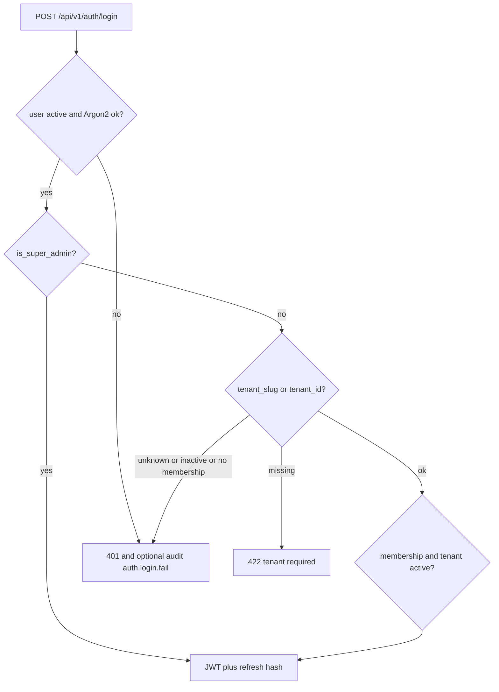
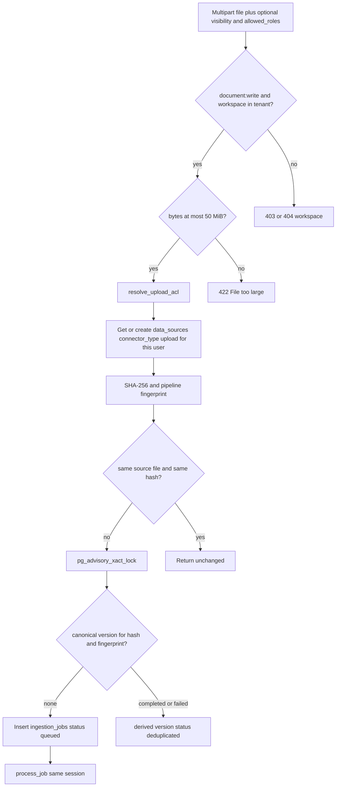
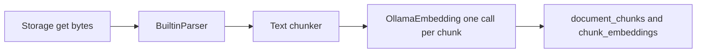
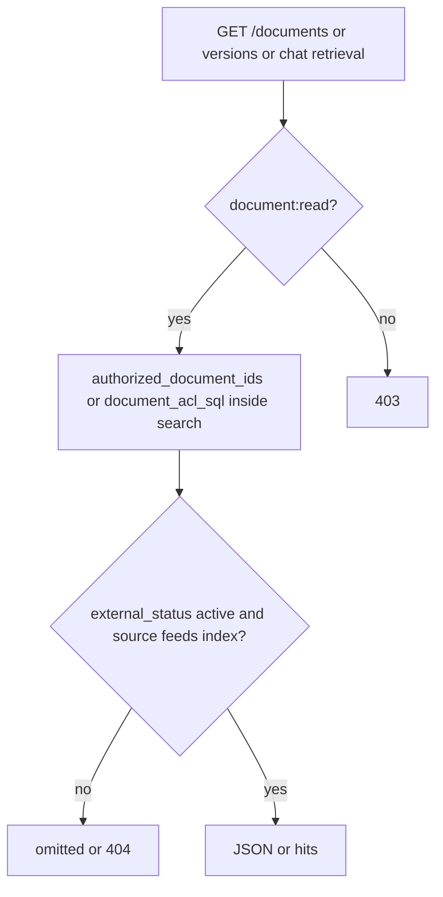
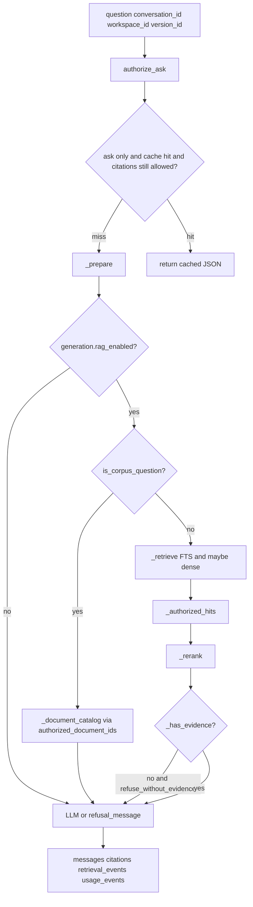
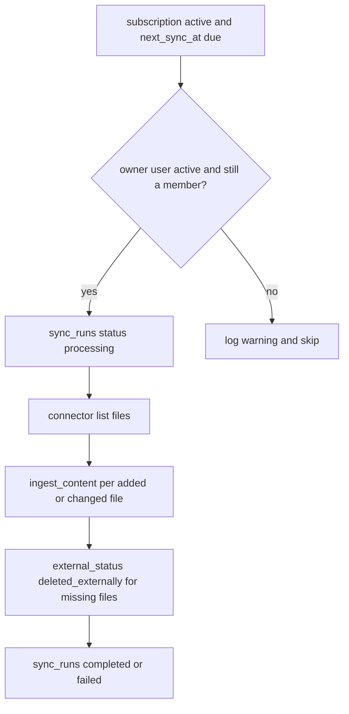

# Business and data flows

Diagrams describe the code paths named under each figure. They are not target flows.

## Signup

`POST /api/v1/auth/signup` → `IdentityService.signup` → `_create_tenant_graph` → `_issue_session`.

Only when `RAG_ALLOW_PUBLIC_SIGNUP` is truthy. Otherwise the route raises `ForbiddenError` before the service.

```mermaid
flowchart TD
  post[POST /api/v1/auth/signup]
  flag{RAG_ALLOW_PUBLIC_SIGNUP?}
  email{email unused and password length at least 10?}
  user[Insert users]
  graph[Tenant org workspace roles membership Tenant Admin]
  tok[Insert refresh_tokens and return JWT]
  post --> flag
  flag -->|no| f403[403 Public signup is disabled]
  flag -->|yes| email
  email -->|no| err[409 or 422]
  email -->|yes| user --> graph --> tok
```

Database writes: `users`, `tenants`, `organizations`, `workspaces`, `roles`, `role_permissions`, `user_roles`, `tenant_memberships`, `refresh_tokens`. No document rows.

## Login



## Upload and ingest

`POST /api/v1/documents` → `IngestionService.upload` → `ingest_content`. For `asyncio` and `taskiq_redis`, `process_job` runs before the request transaction commits.



`process_job` data movement:



FTS needs no extra write: `search_vector` is a generated column.

External calls: storage `put` on first sight of a hash; Ollama `POST /api/embeddings` per chunk. No queue broker call.

## Document read path



Tenant Admin does not skip `ids` unless some role still has `document:read_all`. The seed and migration `009` remove that code from Tenant Admin.

## Chat

`POST /api/v1/chat` and `POST /api/v1/chat/stream`.



Development reranker is `identity`, so any remaining hit counts as evidence (`ChatService._has_evidence`). Hybrid fusion is reciprocal rank fusion (`backend/app/application/fusion.py`) when strategy is `hybrid` and the embedding provider is not `hashing`.

Stream events, in order, from `stream_ask`: `retrieval.completed`, `generation.started`, zero or more `token`, `citations`, `generation.completed` or `error`. The route commits the session before yielding `generation.completed`.

## Connector sync

Manual: `POST /api/v1/subscriptions/{id}/sync` → `ConnectorService.sync` with `trigger=manual`.

Scheduled: API `scheduler_loop` → `run_due_syncs` → `sync(..., trigger=scheduled)` as the source owner.



Sync does not publish a broker event. After `ingest_content`, if the result status is `queued` and `job_id` is set, `ConnectorService.sync` calls `IngestionService.process_job` on the same session (`backend/app/application/connectors.py`). That is the same in-process execution the upload route uses. `unchanged` increments `files_skipped`. `queued` with `version_new` increments `files_updated`. Any other status, including a new file and `deduplicated`, increments `files_added`. Files that disappeared from the listing get `external_status = deleted_externally` and `active_version_id` cleared. If any were marked deleted, `persist_authz_bump` runs. A per-file `get_file` exception increments `files_failed` and continues.
