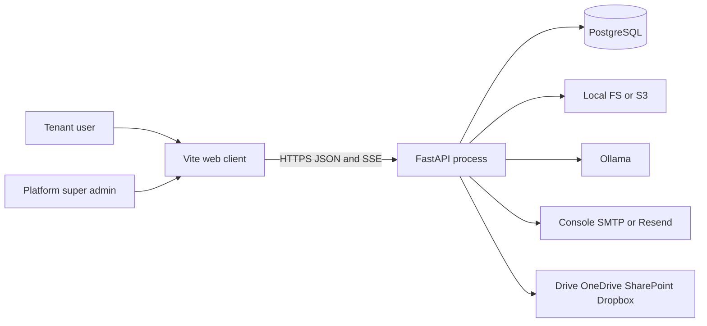
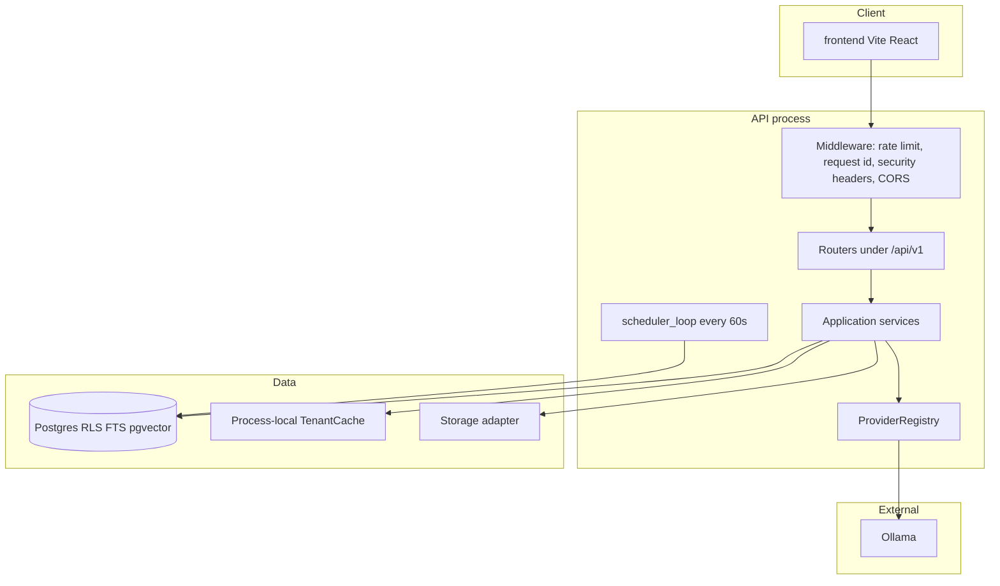

# High-level design

Status: **existing system**, traced from source. Recommendations are not described here.

## 1. Executive summary

The product is a multi-tenant retrieval-augmented generation (RAG) application. A React (Vite) client talks to one FastAPI process. That process owns HTTP, identity, document ACL, ingestion, hybrid retrieval, and chat. PostgreSQL is the system of record: relational data, row-level security policies, full-text search (`tsvector`), and embeddings (`pgvector`). Object bytes go to local disk or S3-compatible storage. Generation and embeddings call Ollama over HTTP in the default configuration.

Background work is not a separate broker. With `queue.provider` of `asyncio` or `taskiq_redis`, upload runs `IngestionService.process_job` in the same database transaction as the upload (`backend/app/api/v1/documents.py`). Both provider names resolve to `AsyncioJobQueue`, which records a handle and does not publish to Redis (`backend/app/adapters/providers/queues/asyncio_queue.py`). A scheduler coroutine inside the API process polls due connector subscriptions every 60 seconds (`backend/app/application/scheduler.py`).

Roles seeded per tenant are **Tenant Admin**, **Member**, and **Viewer** (`SEED_ROLES` in `backend/app/application/rbac.py`). Tenant Admin does not receive `document:read_all`. Member uploads default to private ACL; Tenant Admin uploads default to `visibility: tenant` (`default_upload_acl` in `backend/app/application/authz.py`). The client can override visibility and `allowed_roles` on upload. List, versions, FTS, pgvector search, and chat all apply the same ACL predicate (`document_acl_sql` / `can_read_document` / `authorized_document_ids`).

## 2. Scope

**In scope.** The Python backend under `backend/app`, Alembic migrations, YAML configs, the Vite frontend as a client of `/api/v1`, Docker Compose, GitHub Actions CI, and `scripts/start.sh` / `scripts/stop.sh`.

**Present but not the serving path for local `scripts/start.sh`.** The worker module `python -m app.workers.main`. There is no desktop shell. Access is the web UI.

**Out of scope for this document.** Product demo copy (`DEMO_SCRIPT.md`, `PRODUCT_STORY.md`, `demo/`) when it disagrees with code. Those files may be edited independently.

**Not in the repository.** Kubernetes manifests, a load balancer, an API gateway, a service mesh, a dead-letter queue service, OpenTelemetry exporters, and a Redis client.

## 3. Repository analysis

Layout that the running system actually uses:

| Area | Path | Role |
| --- | --- | --- |
| HTTP entry | `backend/app/main.py` | `create_app()`, middleware, routers, SPA mount, lifespan |
| Worker entry | `backend/app/workers/main.py` | Registers the same job handler, then waits for SIGINT/SIGTERM. Does not dequeue |
| Application services | `backend/app/application/` | Identity, authz, ingestion, chat, connectors, folders, jobs, scheduler, eval |
| Ports and registry | `backend/app/domain/` | Protocols and `ProviderRegistry` |
| Adapters | `backend/app/adapters/` | Postgres, providers, password hashing |
| HTTP routers | `backend/app/api/v1/` | Versioned JSON API |
| Config | `backend/app/config/`, `configs/` | YAML cascade, secret refs, overlay denylist |
| Schema | `backend/alembic/versions/001`–`009`, `backend/app/adapters/db/models.py` | Postgres schema |
| Web UI | `frontend/src/` | Vite + React Router |
| Tests | `tests/unit`, `tests/security`, `tests/integration`, `tests/evaluation` | Pytest; CI job in `.github/workflows/ci.yml` |
| Prior design notes | `docs/HLD.md`, `docs/adr/`, `docs/schema.md` | Useful rationale; several statements are stale (see [DECISIONS.md](DECISIONS.md) and Open questions) |

`backend/app/main.py` registers routers in this order: health, auth, identity, platform, tenant, folders, documents, connectors, chat, eval, admin. `mount_spa` serves a built frontend when static files exist (`backend/app/api/frontend.py`).

## 4. System context

Actors that call the system:

- **Tenant user** (Tenant Admin, Member, or Viewer) via the web UI.
- **Platform super admin** (`users.is_super_admin`) via `/platform` routes. Super admin JWTs have `sa: true` and no tenant id. `RequestContext.has()` does not grant tenant document permissions.
- **Operator** starts processes with `scripts/start.sh` or Docker Compose. There is no in-app operator control plane beyond super-admin HTTP routes.

External systems the process calls:

- **PostgreSQL** (asyncpg). Required for readiness.
- **Ollama** HTTP (`/api/chat`, `/api/embeddings`, `/api/tags`). Default models in `configs/development.yaml`: `llama3.2` (LLM) and `nomic-embed-text` (embeddings, 768 dimensions).
- **S3-compatible storage** when `storage.provider` is `s3` (boto3). Development YAML sets `local_fs`.
- **SMTP or Resend** when email provider is not `console`.
- **Google, Microsoft, Dropbox** HTTP APIs when a connector OAuth flow is used. Implementations exist under `backend/app/adapters/providers/connectors/`.

Evidence: `create_app` in `backend/app/main.py`; provider modules listed in [LLD.md](LLD.md); `configs/development.yaml`.

## 5. High-level architecture

One deployable Python application. Providers are selected by YAML, not by a separate service per capability.

Redis is drawn nowhere in this diagram. `configs/base.yaml` requires `redis.url`, and Compose starts Redis, but no Python module opens a Redis connection. `taskiq_redis` is an alias of the in-process queue. See [DEPLOYMENT.md](DEPLOYMENT.md).

### Components

| Component | Responsibility | Does not |
| --- | --- | --- |
| `create_app` | Wire middleware, routers, lifespan (DB, super-admin seed, job handler, scheduler) | Implement business rules |
| `IdentityService` | Signup, login, refresh rotation, invites, roles, tenant graph, JWT issuance, context hydration | Enforce document ACL |
| `RequestContext` | Per-request principal: tenant, user, roles, teams, permissions | Persist itself |
| `IngestionService` | Upload, content-addressed store, versions, jobs, parse/chunk/embed/index, ACL patch, re-embed | Decide HTTP status codes |
| `ChatService` | Authorize, retrieve, rerank, generate, persist messages and citations, stream SSE | Bypass ACL in SQL |
| `ConnectorService` | Sources, OAuth, subscriptions, sync runs | Own the chunk index schema |
| `FolderService` | Folder tree and `resource_permissions`, compiled into document ACL | Replace document ACL |
| `ProviderFactory` / `ProviderRegistry` | Construct the configured adapter | Implement every name in `KNOWN_PROVIDERS` |
| `AsyncioJobQueue` | Return a `JobHandle` | Deliver work to another process |
| `scheduler_loop` | Call `ConnectorService.sync` for due subscriptions | Run inside the worker module |

### Data flow (summary)

Major flows are drawn in [FLOWS.md](FLOWS.md). Short form:

1. **Login.** Email, password (Argon2), tenant slug or id → membership check → access JWT (HS256) plus hashed refresh token.
2. **Upload.** Multipart file → SHA-256 → `content_objects` → `documents` / `document_versions` → `ingestion_jobs` → same-session `process_job` (parse, chunk, embed, `chunk_embeddings`, generated `search_vector`).
3. **Chat.** Permission and workspace checks → optional rewrite → FTS and/or pgvector with ACL SQL → second Python ACL pass → rerank → Ollama or refusal → `messages`, `message_citations`, `retrieval_events`.
4. **Scheduled sync.** API lifespan loop → subscriptions with `next_sync_at <= now` → sync as the source owner → `ingest_content` for changed files.

### Deployment shape

Local script: uvicorn on `127.0.0.1:8000`, Vite on `5173`. Postgres, Redis, and Ollama are assumed already running; the script does not start them (`scripts/start.sh`). Compose adds Postgres (pgvector pg16), Redis 7, MinIO, Ollama, API, worker, and frontend (`docker/docker-compose.yml`). There is no Kubernetes manifest in the repo. Detail: [DEPLOYMENT.md](DEPLOYMENT.md).

### Scalability

**Existing.**

- SQLAlchemy async pool: `pool_size=5`, `max_overflow=10`, `pool_recycle=1800`, `pool_pre_ping=True` (`backend/app/adapters/db/session.py`). Tests and `RAG_DB_NULL_POOL=1` use `NullPool`.
- Pagination caps at 100 (`backend/app/api/pagination.py`), except audit logs which allow query `le=200` and then the service still uses the session query limit from the route.
- Hybrid retrieval `top_k` is validated between 1 and 100.
- Chat answers with citations are cached in a process-local LRU of 2048 entries (`backend/app/core/cache.py`).
- Rate limits: 180 requests / 60s per IP+tenant for general API (middleware constructed in `create_app`), and `RAG_AUTH_RATE_LIMIT` (default 10) / `RAG_AUTH_RATE_WINDOW` (default 60) for auth paths. A Postgres table `rate_limit_buckets` is the shared counter. If that query fails, the process-local counter still applies (`backend/app/core/rate_limit.py`).
- Embeddings are one HTTP call per chunk (`OllamaEmbedding.embed_documents`).

**Not implemented.** Horizontal autoscaling, a shared cache, queue partitioning, read replicas, or embedding batch APIs. Multiple API replicas would each run `scheduler_loop` and could sync the same subscription concurrently. Rationale for a single scheduler with no leader lock: "Rationale not evident from repository."

### Reliability

**Existing.**

- `/api/v1/health/live` always returns `{"status":"ok"}` without checking dependencies.
- `/api/v1/health/ready` runs `SELECT 1`. Failure returns HTTP 503 `{"status":"unavailable"}`.
- `/api/v1/health` probes Ollama `GET /api/tags` with a 2 second timeout and returns `degraded` when Ollama is down. It does not fail the process.
- Ingestion failures inside `process_job` roll back the nested transaction (chunks) and set the job to `failed`, or `dead_letter` when `attempts >= 3`. There is no sleep/backoff. Retry is `POST /api/v1/jobs/{job_id}/retry`, which calls `process_job` again.
- `AsyncioJobQueue.cancel` is a no-op.
- Startup calls `IdentityService.ensure_super_admin()` and swallows all exceptions (`create_app` lifespan).
- `try_init_engine` swallows database init errors so the process can boot before Postgres is up. Ready will then be 503.
- Scheduler tick exceptions are logged; the loop continues.
- Unhandled HTTP exceptions become a generic 500 problem body (`backend/app/api/errors.py`). The exception message is not returned.

**Not implemented.** Automatic requeue, exponential backoff, a broker DLQ, job leasing, or crash recovery that resumes `processing` jobs. ADR 006 describes those properties; the code does not implement them. See [DECISIONS.md](DECISIONS.md).

### Security (summary)

Detail is [SECURITY.md](SECURITY.md).

- Password hashing: Argon2 (`backend/app/core/security.py`).
- Access tokens: JWT HS256, default TTL 900 seconds. Claims: `sub`, `typ=access`, `jti`, `iat`, `exp`, optional `tid`, `wid`, `sa`.
- Refresh tokens: random 32 bytes, stored as SHA-256, rotated on refresh (previous row `revoked_at` set).
- Every authenticated tenant request reloads roles and permissions from Postgres (`IdentityService.hydrate_context`). The JWT does not carry the permission set.
- Postgres RLS policies compare `tenant_id` to `app_security.current_tenant_id()` backed by `set_config('app.tenant_id', ..., true)`. Document ACL is enforced in application SQL, not by a second RLS policy.
- Production startup refuses weak JWT secrets, public signup, CORS `*`, and unsafe email settings (`enforce_runtime_safety`).

### Observability

**Existing.**

- structlog JSON logs, level from `observability.log_level` (`backend/app/core/logging.py`).
- `RequestIdMiddleware` accepts `x-request-id` or generates a UUID, binds it on the structlog context, and echoes `x-request-id` on the response.
- Audit rows (`audit_logs`) for login success/failure, authz denial, document share, and other identity actions. `request_id` is a column.
- `retrieval_events` stores the search query (empty string when `privacy.store_queries` is false), retriever/reranker/llm/embedding names, chunk ids, and latency. It does not store the full LLM prompt.
- `ChatService._persist` inserts `usage_events` with `event_type=chat`, provider, and model. `input_tokens` and `output_tokens` stay at the column default 0. `OllamaLLM.generate` returns an empty `TokenUsage`. `GET /api/v1/usage` sums those zeros plus any other rows.

**Not implemented.** `observability.otel_enabled` is a boolean on `ObservabilityConfig`. `backend/app/observability/__init__.py` contains only the comment that OpenTelemetry hooks land later. No Prometheus metrics, no trace exporter, no log redaction pipeline. `privacy.redact_pii` defaults to false and no redaction call site was found in the chat path.

## 6. End-to-end use cases (high level)

| Use case | Actor | Where the detail lives |
| --- | --- | --- |
| Sign up and receive a tenant | Public caller, only if `RAG_ALLOW_PUBLIC_SIGNUP` is truthy | [FLOWS.md](FLOWS.md), [SEQUENCES.md](SEQUENCES.md) |
| Log in to a tenant | Member, Viewer, Tenant Admin | [SECURITY.md](SECURITY.md) |
| Upload a document and index it | Caller with `document:write` | [LLD.md](LLD.md), [SEQUENCES.md](SEQUENCES.md) |
| Change who can read a document | Owner with `document:write`, or `source:admin` | [SECURITY.md](SECURITY.md) |
| Ask a question with citations | Caller with `document:read` at the route | [SEQUENCES.md](SEQUENCES.md) |
| Sync a connected folder | `source:manage` owner, or the scheduler as that owner | [FLOWS.md](FLOWS.md) |
| Invite a user | `users.create` or `user:manage` | [API.md](API.md) |
| Platform tenant administration | Super admin | [API.md](API.md) |

Preconditions, alternates, and database writes are in [LLD.md](LLD.md) under use cases.

## 7. Technology inventory

| Category | Technology | Purpose | Evidence |
| --- | --- | --- | --- |
| Language | Python ≥ 3.12 | API and domain | `backend/pyproject.toml` |
| HTTP | FastAPI, uvicorn | API process | `backend/app/main.py`, `pyproject.toml` |
| Validation | Pydantic v2 | Settings and request bodies | `backend/app/config/models.py`, route modules |
| ORM | SQLAlchemy 2 asyncio | Persistence | `backend/app/adapters/db/` |
| Migrations | Alembic | Schema `001`–`009` | `backend/alembic/versions/` |
| Database | PostgreSQL + pgvector + citext | System of record, vectors, case-insensitive email | migration `001` |
| Driver | asyncpg (app), psycopg (sync URL for Alembic) | Connections | `pyproject.toml`, `.env.example` |
| FTS | Postgres `tsvector` generated column, GIN index | Sparse retrieval | migration `001`, `PostgresFTSIndex` |
| Vectors | pgvector `vector` column, cosine distance `<=>` | Dense retrieval | `PgVectorStore.search` |
| Cache | In-process `OrderedDict` LRU | Chat answer cache | `backend/app/core/cache.py` |
| Rate limit | Process memory + `rate_limit_buckets` | HTTP throttling | `backend/app/core/rate_limit.py`, migration `008` |
| Passwords | argon2-cffi | Password hashes | `backend/app/core/security.py` |
| Tokens | PyJWT HS256 | Access tokens | `issue_jwt` |
| HTTP client | httpx | Ollama, connectors, health | `ollama.py`, `health.py` |
| Parsing | PyMuPDF, python-docx, openpyxl, python-pptx, stdlib csv/html | Builtin parser | `pyproject.toml`, `builtin.py` |
| Object storage | Local filesystem or boto3 S3 | Raw bytes | `storage/local_fs.py`, `storage/s3.py` |
| LLM / embeddings | Ollama by default | Generation and vectors | `configs/development.yaml` |
| Email | console, smtplib, or Resend HTTP | Invites and resets | `adapters/providers/email/` |
| Web UI | React, Vite, React Router | Browser client | `frontend/package.json`, `frontend/src/App.tsx` |
| Containers | Docker Compose | postgres, redis, minio, ollama, api, worker, frontend | `docker/docker-compose.yml` |
| CI | GitHub Actions | ruff, alembic, pytest, frontend build | `.github/workflows/ci.yml` |
| Logging | structlog JSON | Request logs | `backend/app/core/logging.py` |
| Config | PyYAML + dotenv | Layered settings | `backend/app/config/load.py` |

Redis 7 is in Compose and `RedisConfig` is required on `PlatformSettings`. It is not in the inventory as a runtime dependency of application logic because no adapter connects to it.

## 8. Repository-to-architecture mapping

| Component | Path | Key files |
| --- | --- | --- |
| Process entry | `backend/app/main.py` | `create_app`, `app` |
| Worker entry | `backend/app/workers/main.py` | `main` |
| Auth HTTP | `backend/app/api/v1/auth.py` | signup, login, refresh, me |
| Authz | `backend/app/application/authz.py`, `rbac.py`, `core/permissions.py` | `can_read_document`, `document_acl_sql`, `SEED_ROLES` |
| Request principal | `backend/app/api/deps.py`, `core/context.py` | `get_context`, `require_permission` |
| Ingestion | `backend/app/application/ingestion.py` | `IngestionService` |
| Jobs | `backend/app/application/jobs.py` | `run_ingestion_job` |
| Scheduler | `backend/app/application/scheduler.py` | `scheduler_loop`, `run_due_syncs` |
| Chat / RAG | `backend/app/application/chat.py`, `fusion.py`, `query.py` | `ChatService`, `reciprocal_rank_fusion` |
| Connectors | `backend/app/application/connectors.py` | `ConnectorService.sync` |
| Folders | `backend/app/application/folders.py` | `FolderService` |
| Vector search | `backend/app/adapters/providers/vectorstores/pgvector_store.py` | `PgVectorStore` |
| FTS | `backend/app/adapters/providers/sparse_indexes/postgres_fts.py` | `PostgresFTSIndex` |
| Ollama | `backend/app/adapters/providers/llm/ollama.py`, `embeddings/ollama.py` | `OllamaLLM`, `OllamaEmbedding` |
| Schema | `backend/app/adapters/db/models.py` | SQLAlchemy models |
| RLS | `backend/app/adapters/db/rls.py`, migration `001` | `apply_rls` |
| Frontend routes | `frontend/src/App.tsx` | Chat, documents, folders, sources, admin, platform |
| API client | `frontend/src/api/client.ts` | `apiBase`, bearer token in `localStorage` |
| Local run | `scripts/start.sh`, `scripts/stop.sh` | uvicorn + Vite |

## 9. Conflict with older docs

| Older statement | Code |
| --- | --- |
| `docs/HLD.md` and `docs/schema.md`: roles Admin, Manager, Member, Viewer | `SEED_ROLES` is Tenant Admin, Member, Viewer. No Manager role is seeded |
| `docs/HLD.md` bounded-context table: connectors are "Mock providers only" | Live adapters are registered for `local_fs`, `s3`, `google_drive`, `onedrive`, `sharepoint`, `dropbox`, plus `mock_*`. The same HLD file later describes the live catalog. The table is stale |
| ADR 006: Taskiq + Redis transport, exponential backoff, cancellation, idempotency key includes `embedding_profile_id` | Queue implementation is in-process. `cancel` returns immediately. No backoff sleep. Idempotency key is `{tenant}:{source_id}:{source_file_id}:{content_hash}:{embedding.model}` in `IngestionService.ingest_content` |
| ADR 008 title "before retrieval" | ACL SQL is inside `PgVectorStore.search` and `PostgresFTSIndex.search`. `ChatService._authorized_hits` filters again in Python before rerank. Both exist |

## 10. Open questions

1. Migration `009_document_visibility_defaults.py` and the ACL default changes in `authz.py`, `rbac.py`, `ingestion.py`, and `documents.py` are in the working tree. At the start of this documentation pass, git status showed `009` as untracked and those modules as modified. The behavior above is what those files implement now. Whether that revision is merged is outside this document.
2. Another agent may be editing the product demo (frontend journey, seed data, `DEMO_SCRIPT.md`, `PRODUCT_STORY.md`). Those files were not used as the source of architecture. If demo seed data creates roles or ACLs that differ from `SEED_ROLES` / `default_upload_acl`, that difference is not verified here.
3. Local Postgres started outside Compose may be a superuser. Superusers bypass RLS even when `FORCE ROW LEVEL SECURITY` is set. Compose `POSTGRES_USER=rag` is the cluster superuser. Application queries also filter `tenant_id`. Whether production is expected to use a non-superuser role is not stated.
4. `OllamaEmbedding._base` returns `http://127.0.0.1:11434` and does not read `OLLAMA_BASE_URL` or `llm.api_base`. `OllamaLLM` does honor `llm.api_base`. In Compose, the API container's loopback is not the Ollama container. Whether embeddings are expected to work inside Compose is unclear from code.
5. `otel_enabled: true` in staging and production YAML has no exporter. Rationale for the flag without an implementation: the observability module says hooks land later.
6. `ingestion_jobs.status` allows `cancelled`. No application assignment of `cancelled` was found.
7. `app.user_id` is set by `apply_rls` but RLS policies inspected in migrations filter only `tenant_id`.
8. Names in `KNOWN_PROVIDERS` without `@register` (anthropic, gemini, qdrant, celery, rabbitmq, oidc, tesseract, unstructured, and others) are valid config strings and then fail at `ProviderRegistry.get` with `ProviderNotImplementedError`. Which of those are planned is not specified beyond the catalog.
9. Chat route requires `document:read`, while `ChatService.authorize_ask` also accepts `conversation:write` or `ai.chat`. The route dependency runs first, so the service check is wider than the HTTP gate. Rationale not evident from repository.
10. `POST /documents/{id}/acl` requires `document:read`, then `can_share_document`. A viewer who is not the owner receives `NotFoundError` ("Document not found"), not 403. This matches an IDOR-hiding pattern used elsewhere; the comment that states that intent was not found on this handler.
