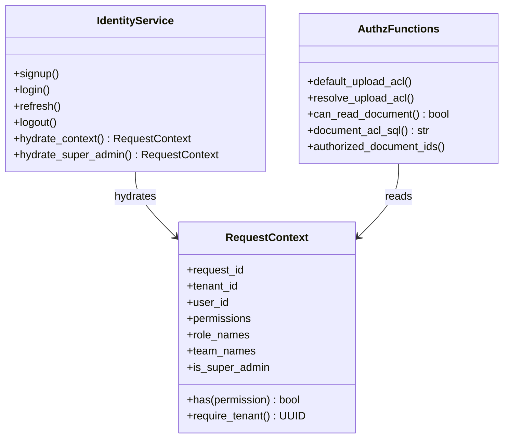
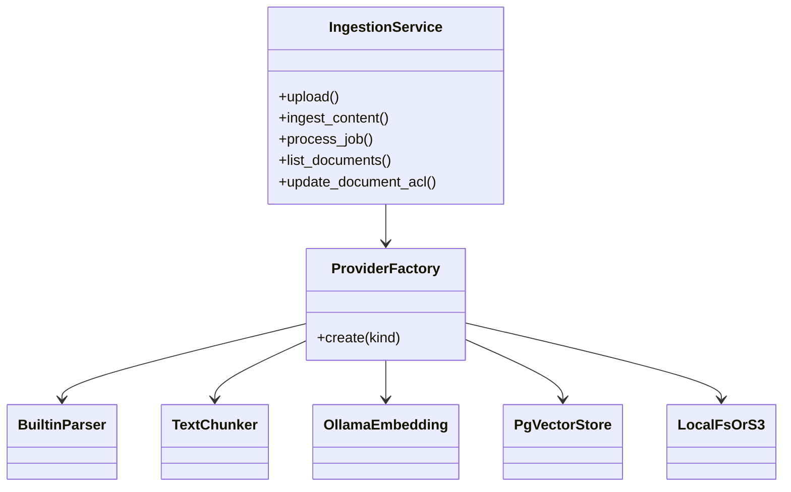
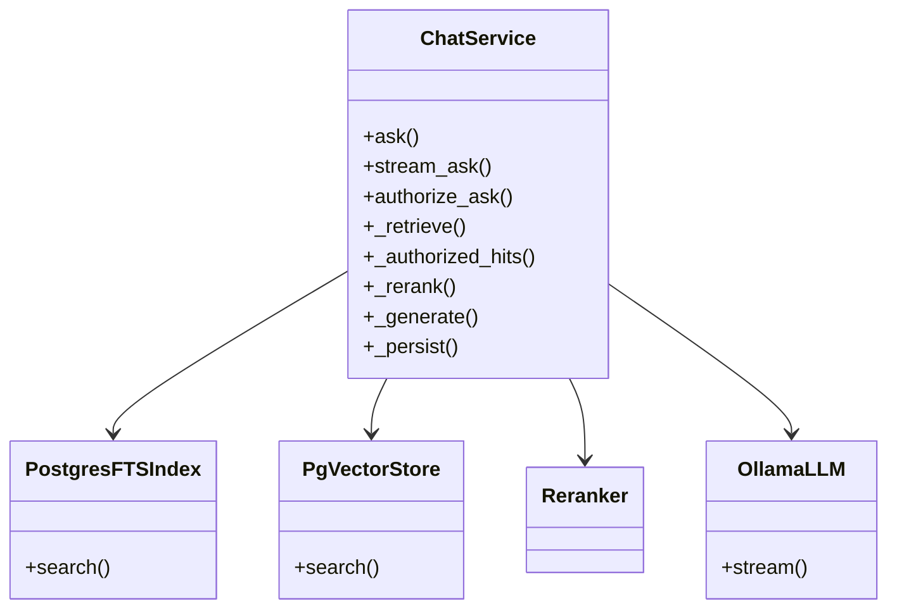
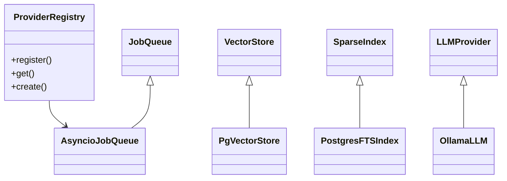
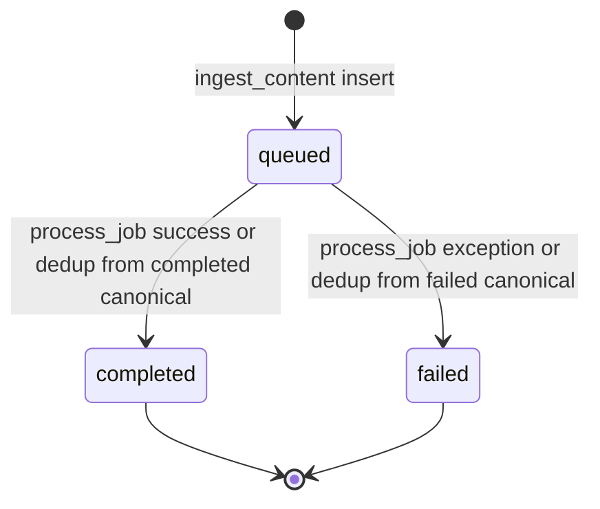
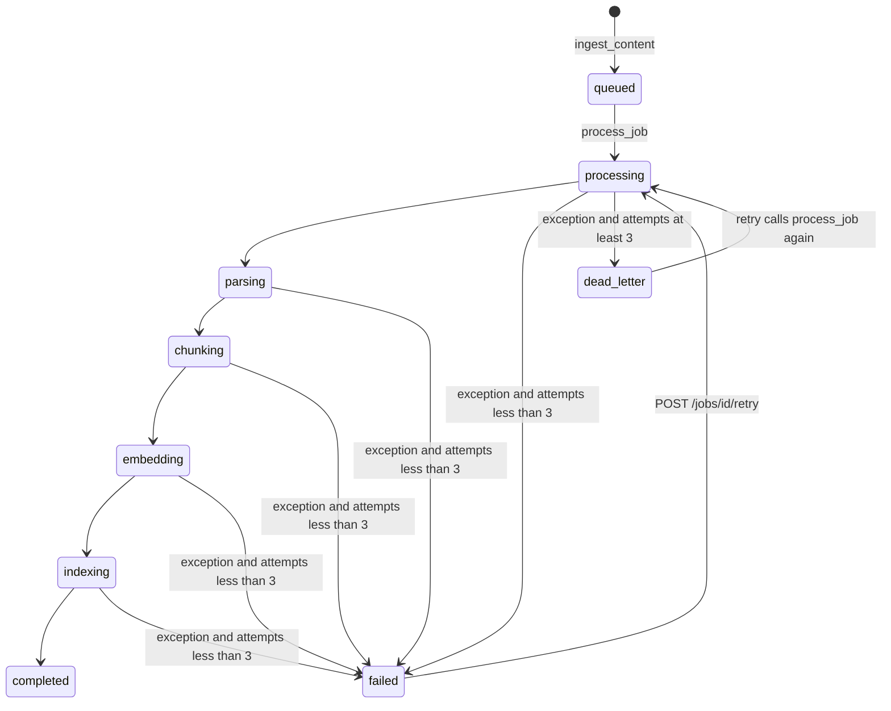
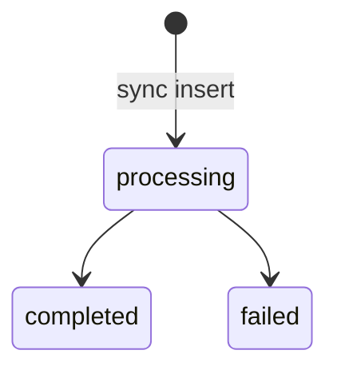

# Low-level design

Existing behavior. Failure cases say **not implemented** when no handler exists.

## 1. Module map

| Module | Responsibility | Does not |
| --- | --- | --- |
| `app.main` | Construct FastAPI, middleware, lifespan | Query business tables except super-admin seed |
| `app.api.v1.*` | Parse HTTP, call one service, map errors via global handlers | Embed ACL SQL |
| `app.api.deps` | JWT, `RequestContext`, permission dependencies, tenant settings merge | Issue tokens |
| `app.application.identity` | Accounts, tenants, roles, invites, hydration | Document ACL |
| `app.application.authz` | ACL JSON, SQL predicate, authorized id list | HTTP |
| `app.application.rbac` | Permission catalog and seed role tuples | Read the database by itself |
| `app.application.ingestion` | Upload, versions, jobs, re-embed | Connector listing |
| `app.application.jobs` | Re-hydrate caller and run one job | Schedule |
| `app.application.chat` | RAG ask and stream | Parse files |
| `app.application.connectors` | Sources, OAuth, sync | Own chunk schema |
| `app.application.folders` | Folder ACL compilation | pgvector queries |
| `app.application.scheduler` | 60s due-sync loop | Start from the worker module |
| `app.application.factory` | `ProviderFactory.create` | Register providers (imports do) |
| `app.domain.registry` | Name → factory | Know Postgres |
| `app.adapters.db` | Engine, RLS GUCs, ORM | Business rules |
| `app.adapters.providers.*` | Ollama, FTS, pgvector, storage, mail, connectors | Choose the tenant's ACL |
| `app.core.*` | Errors, JWT, cache, rate limit, logging, flags | Persistence of domain rows |
| `app.config.*` | YAML, secrets, denylist | Runtime provider calls |
| `app.workers.main` | Log queue provider name and wait for a signal | Pull jobs |

## 2. Important types

| Component | Responsibility | Dependencies | Important methods |
| --- | --- | --- | --- |
| `RequestContext` | Frozen principal | `permissions_include` | `has`, `require_tenant` |
| `IdentityService` | Identity use cases | session, `PlatformSettings`, models | `signup`, `login`, `refresh`, `hydrate_context`, `me`, `_issue_session`, `_create_tenant_graph` |
| `IngestionService` | Document pipeline | session, settings, ctx, `ProviderFactory` | `upload`, `ingest_content`, `process_job`, `list_documents`, `list_versions`, `update_document_acl`, `reembed_active` |
| `ChatService` | Answer a question | session, settings, ctx, factory, cache | `ask`, `stream_ask`, `authorize_ask`, `_prepare`, `_retrieve`, `_authorized_hits`, `_generate` |
| `ConnectorService` | External files | session, settings, ctx, ingestion | `sync` |
| `FolderService` | Folders and grants | session, ctx | `list_folders`, `create_folder`, `share_folder`, `_compile_and_apply` |
| `ProviderFactory` | Build adapters | `PlatformSettings`, registry | `create` |
| `AsyncioJobQueue` | Queue port stand-in | `RequestContext` | `enqueue`, `cancel` |
| `PgVectorStore` | Dense search | session, ACL SQL | `upsert`, `search` |
| `PostgresFTSIndex` | Lexical search | session, ACL SQL | `search` |
| `OllamaLLM` | Chat completions | httpx, `LLMConfig` | `generate`, `stream` |
| `OllamaEmbedding` | Vectors | httpx, hardcoded base URL | `embed_documents`, `embed_query` |
| `TenantCache` | LRU | process memory | `get_tenant`, `set_tenant` |
| `PlatformError` hierarchy | API errors | `app.api.errors` | `code`, `status_code` |

### Class diagram — identity and authz



`AuthzFunctions` is not a class. The diagram groups free functions in `backend/app/application/authz.py`.

### Class diagram — ingestion



Chunker class is the type registered as `recursive`, `fixed`, `token`, `sentence`, and `markdown` in `backend/app/adapters/providers/chunkers/text.py`.

### Class diagram — chat



Development reranker is `IdentityReranker` (`backend/app/adapters/providers/rerankers/identity.py`). `LexicalReranker` is registered and unused by development YAML.

### Class diagram — providers



Ports live in `backend/app/domain/ports/`. `AsyncioJobQueue` is registered twice: `asyncio` and `taskiq_redis`.

## 3. Business rules

### Upload ACL

Implemented by `resolve_upload_acl` / `default_upload_acl`.

- No user id → `ValidationFailedError`.
- Omitted visibility and omitted roles → `default_upload_acl`.
- Member default: `visibility=private`, `allowed_users=[owner]`.
- Tenant Admin default: same, with `visibility=tenant`.
- Explicit `visibility` must be `private` or `tenant`.
- `allowed_roles` normalized to Member, Viewer, Tenant Admin.

`upload` passes that dict as `acl` into `ingest_content`. `_document_acl` merges it onto `owner_acl` via `merge_acl`, so the owner remains on `allowed_users`.

File size cap: 50 MiB (`len(content) > 50 * 1024 * 1024`).

Same `(source_id, source_file_id)` and same SHA-256 → `unchanged`, active version kept, ACL still updated to the effective ACL.

### Ingestion job execution

`process_job`:

1. Missing job returns without error.
2. Tenant mismatch, missing version, or missing source → job `failed` with an error string.
3. `derived_from_version_id` set → job `completed` without parsing.
4. Else status `processing`, `attempts += 1`, then nested transaction: storage get, `parsing`, `chunking`, `embedding`, `indexing`, version and job `completed`, `_stamp_derived`.
5. Exception: refresh ORM rows, job `failed` if `attempts < 3` else `dead_letter`, version `failed`, stamp derived failed.

There is no sleep between attempts. The third failure becomes `dead_letter` only if `process_job` is invoked again until `attempts` reaches 3. The first call starts from 0 and increments to 1.

`run_ingestion_job` (`jobs.py`) opens a **new** session, checks tenant, active tenant, active user, source, then `hydrate_context`. It is used by `POST /jobs/{id}/retry` and by the `BackgroundTasks` branch. The upload and sync paths call `process_job` directly on the request session instead, so they do not double-wrap hydration. The upload caller is already hydrated.

### Retrieval

`_retrieve`:

1. Build `VectorFilter` via `retrieval_filter` (tenant, user, teams, roles, `read_all`, optional workspace and version, embedding provider and model).
2. FTS `search` with `retrieval.sparse.top_k`.
3. If `is_overview_question`, add another FTS query (`FTS_OVERVIEW`) and up to 8 intro chunks (`_intro_hits`), still ACL-filtered.
4. If embedding provider is `hashing` or strategy is `sparse`, return unique sparse hits truncated to `retrieval.top_k`. No dense call.
5. Else embed the query and `PgVectorStore.search` with `retrieval.dense.top_k`.
6. Strategy `hybrid` → `reciprocal_rank_fusion([dense, sparse+extra])` then truncate. Other non-sparse strategies return dense only.

`PostgresFTSIndex.search` swallows all exceptions and returns `[]`. Dense search does not.

Corpus questions (`is_corpus_question`) skip retrieval and load `authorized_document_ids` titles into the prompt (`_document_catalog`).

### Generation

`_generate` refuses with `generation.refusal_message` when RAG is on, `refuse_without_evidence` is on, and `_has_evidence` is false. Identity reranker: any candidate is evidence. The development config therefore refuses only when the filtered hit list is empty (or RAG is off, in which case refusal is not taken).

`privacy.store_queries` (default true) controls whether `retrieval_events.query` stores the rewritten search string or `""`. `privacy.store_llm_prompts` is not consulted in `_persist`. The assistant message `content` stores the answer. `_persist` also inserts a `usage_events` row with zero token counts.

### Chat cache

`ask` only. Key `chat:{workspace_id}:{question.strip().lower()}`, scoped with tenant, user, and DB authz epoch. Stored only when `citations` is non-empty. On read, every cited document must still be live and `can_read_document`. `stream_ask` does not consult the cache.

### Folders

`folders.view` lists every folder in the tenant. Without it, `_listable_folder_ids` plus `_can_view` restrict the list. Create/update/delete/share check `folders.*` codes, which Tenant Admin and Member receive through grants from `document:write` (Member's seed includes `document:write` and also explicit `folders.create` / `folders.share`). Viewer does not.

Sharing a folder writes `resource_permissions` and `_compile_and_apply` pushes allow/deny into document ACL for documents in the folder. Inheritance detail is in `FolderService._compile_acl_extra` and tests `tests/security/test_folder_inheritance.py`.

## 4. Use cases

### UC1. Sign up

| | |
| --- | --- |
| Description | Create a user and a tenant, return tokens |
| Actors | Anonymous caller |
| Preconditions | `RAG_ALLOW_PUBLIC_SIGNUP` truthy; email unused; password length ≥ 10 |
| Main flow | Insert user → `_create_tenant_graph` → `_issue_session` |
| Alternates | Duplicate email → 409 `conflict`. Flag off → 403 |
| Failures | DB error → 500 generic body. No partial-commit handler beyond the request transaction |
| Sequence | [SEQUENCES.md](SEQUENCES.md) authentication |
| Data flow | [FLOWS.md](FLOWS.md) |
| DB changes | users, tenants, organizations, workspaces, roles, role_permissions, user_roles, tenant_memberships, refresh_tokens |
| External calls | None |
| Events | None |
| Postconditions | Caller is Tenant Admin of a new active tenant |

### UC2. Login

| | |
| --- | --- |
| Description | Exchange password for JWT and refresh token |
| Actors | Tenant user or super admin |
| Preconditions | User `status=active`, password matches, tenant membership for non-super-admin |
| Main flow | `IdentityService.login` |
| Alternates | Super admin ignores tenant membership and gets `sa=true` with null tenant |
| Failures | 401 identical message for bad password, missing user, inactive user, bad tenant, missing membership |
| DB changes | `users.last_login_at`, `refresh_tokens` insert, `audit_logs` |
| External calls | None |
| Postconditions | Refresh hash stored; raw refresh returned once |

### UC3. Upload and index

| | |
| --- | --- |
| Description | Store a file and make chunks searchable under the upload ACL |
| Actors | Caller with `document:write` |
| Preconditions | Workspace in tenant; file ≤ 50 MiB |
| Main flow | `upload` → `ingest_content` → `process_job` |
| Alternates | Unchanged hash; deduplicated canonical; explicit visibility |
| Failures | Ollama error marks job failed inside the same transaction (nested rollback of chunks). See failure catalog |
| Sequence | [SEQUENCES.md](SEQUENCES.md) |
| DB changes | data_sources (uploads), content_objects, documents, document_versions, ingestion_jobs, document_chunks, embedding_profiles, chunk_embeddings |
| External calls | Storage put; Ollama embeddings |
| Events | No broker message. Optional audit is not written by `upload` itself (share writes audit; upload does not call `write_audit`) |
| Postconditions | Version `completed` or `failed` / `deduplicated` / `unchanged` as returned to the client |

### UC4. Chat

| | |
| --- | --- |
| Description | Answer from authorized chunks or refuse |
| Actors | Caller with route permission `document:read` |
| Preconditions | Active membership; workspace if provided belongs to tenant; version if provided is readable |
| Main flow | `authorize_ask` → `_prepare` → `_generate` → `_persist` |
| Alternates | Cache hit; corpus question; stream SSE; refusal |
| Failures | Ollama 502 on `ask`. Stream yields `{"event":"error","message":"Generation failed"}` and does not raise |
| DB changes | conversations, messages, message_citations, retrieval_events, usage_events (token counts left at 0) |
| External calls | Ollama embed (unless sparse/hashing/corpus) and Ollama chat |
| Postconditions | Message id returned, or SSE `generation.completed` after commit |

### UC5. Scheduled sync

| | |
| --- | --- |
| Description | Pull a subscription as its owner |
| Actors | API process scheduler |
| Preconditions | Tenant active; subscription active; `next_sync_at` due; source has an active member owner |
| Main flow | `run_due_syncs` → `ConnectorService.sync` |
| Alternates | Skip and log on authz or missing owner |
| Failures | Exception logged `scheduled_sync_failed`; other subscriptions continue |
| DB changes | sync_runs, documents, versions, jobs, chunks as in UC3 |
| External calls | Connector `list_files` / `get_file`, then the same embed path |
| Postconditions | `sync_runs.status` `completed` or `failed` |

## 5. State machines

### Document version

Writers: model default `pending`; `ingest_content` inserts `queued`; `process_job` sets `completed` or `failed`; dedup copies canonical `completed` or `failed`. Query `_canonical_version` also treats `processing` as eligible. `process_job` does not set version status to `processing` (that word is used on the **job** and on **sync runs**).



`pending` is the SQL default and is not what `ingest_content` writes.

### Ingestion job



`cancelled` is allowed by the check constraint and has no writer in application code.

Derived jobs: if `version.derived_from_version_id` is set, `process_job` sets the job to `completed` immediately. The dedup return path in `ingest_content` often does not insert a job at all when a canonical already exists (`status: deduplicated`).

### Sync run

Inserted as `processing`, then `completed` or `failed` (`ConnectorService.sync`). Table default `queued` is unused by `sync`.



### Data source

Default `disconnected`. OAuth/connect sets `connected`. Sync failure sets `auth_expired` or `sync_failed`. Disconnect sets `disconnected`. Subscription disconnect sets subscription `disconnected` (`connectors.py`).

### Tenant and user

`status` strings. Login and job hydration require `active`. Other values fail closed. No state enum in the database.

## 6. Async, queues, and cron

| Question | Answer |
| --- | --- |
| Producer | `IngestionService.ingest_content` calls `AsyncioJobQueue.enqueue` |
| Consumer | None. `enqueue` returns `JobHandle` and does not invoke `set_job_handler` |
| Who runs the work | `documents.py` upload handler and `ConnectorService.sync` call `process_job` inline. `POST /jobs/{id}/retry` calls `run_ingestion_job` |
| Broker | Not used. Redis URL is configuration only |
| Event schema | Payload dict `{"job_id": ...}` is passed to `enqueue` and ignored |
| Delivery | In-process function call, same DB transaction as the producer for upload and sync |
| Ordering | Sequential `await` in the sync file loop. No cross-job ordering |
| Retry | Manual HTTP retry. No delay. Attempts increment each `process_job` |
| DLQ | Status `dead_letter` on the row. No side queue |
| Idempotency | Unique `(tenant_id, idempotency_key)`. Key includes tenant, source, source file id, content hash, embedding model. Duplicate key is an uncaught integrity error |
| Dedup | Content hash + pipeline fingerprint canonical version |
| Failure | Nested rollback; job row updated; exception logged in `run_ingestion_job` and swallowed. `process_job` itself catches and does not re-raise |
| Cron | `scheduler_loop` every 60 seconds in the API lifespan only |

`BackgroundTasks.add_task(run_ingestion_job, ...)` runs only when the queue provider is not `asyncio` or `taskiq_redis`. Both registered providers are in that set, so the branch is not taken for valid current config.

## 7. Cross-cutting

### Errors

Hierarchy in `backend/app/core/errors.py`: `PlatformError` and subclasses `ConfigError`, `UnknownProviderError`, `ProviderNotImplementedError` (501), `SecretResolutionError`, `OverlayDeniedError` (403), `UnauthenticatedError` (401), `ForbiddenError` (403), `NotFoundError` (404), `ConflictError` (409), `ValidationFailedError` (422), `RateLimitedError` (429), `BudgetExceededError` (402), `ConnectorError` (502), `ConnectorAuthExpiredError` (401), `ConnectorRateLimitedError` (429). `RuntimeSafetyError` extends `ConfigError` with code `runtime_safety`.

HTTP body (`problem()`):

```json
{
  "type": "about:blank",
  "title": "Not Found",
  "status": 404,
  "detail": "Document not found",
  "code": "not_found",
  "request_id": "uuid"
}
```

`request_id` is omitted when missing. Validation adds `errors: [{loc, msg, type}]` and does not echo raw input. Unhandled exceptions hide the message.

### Logging and correlation

`RequestIdMiddleware` uses header `x-request-id` or a new UUID, binds structlog context vars, sets `request.state.request_id`, and returns the header. Audit rows copy `ctx.request_id` when callers pass it. Login passes `request.state.request_id`.

No structured redaction of passwords. Login failure audit metadata includes `email`. Config GET redacts secret-like keys.

### Cache

| Item | Value |
| --- | --- |
| Implementation | `TenantCache` process-local LRU, max 2048 |
| Key | `{tenant_id}:{user_id}:{authz_epoch}:{logical}` |
| Logical chat key | `chat:{workspace_id}:{normalized question}` |
| TTL | None. Eviction is LRU or epoch bump |
| Invalidation | `persist_authz_bump` updates Postgres epoch and drops matching keys in **this** process |
| Stampede control | Not implemented |

### Locks, races, idempotency

- Transaction-scoped advisory lock around content-address creation.
- Nested transaction plus unique `(tenant_id, content_hash)` for content objects.
- Job idempotency unique key without an application-level upsert.
- Refresh rotation revokes the presented hash then inserts a new row in the same transaction.
- Scheduler has no lease. Two API processes can `sync` the same subscription. Rationale not evident from repository.
- Chat stream commits mid-response so a client reload sees the message. If the commit fails, the exception path yields `error`.

### Expensive operations

| Operation | Evidence |
| --- | --- |
| One HTTP embed per chunk | `OllamaEmbedding.embed_documents` loop |
| Upload waits for the full pipeline | `documents.py` awaits `process_job` |
| Sync waits for every file's pipeline | `connectors.py` awaits `process_job` inside the file loop |
| FTS and vector SQL with JSONB existence checks | `document_acl_sql` |
| No ANN index creation in `PgVectorStore.create_collection` | method returns `None`. Migration `001` creates the `vector` column and does not add an ivfflat or hnsw index |
| Reindex | `POST /api/v1/admin/reindex` re-embeds every visible live document in the request |

## 8. Failure scenarios

| Scenario | Actual behavior | Recovery |
| --- | --- | --- |
| DB unavailable at startup | `try_init_engine` swallows the error. Lifespan super-admin seed is skipped (`except Exception: pass`) | Process stays up. `/health/ready` returns 503 until a later request calls `session_factory` and raises `RuntimeError` if the engine is still missing. **Automatic reconnect on a later request is not implemented** after a failed init; `init_engine` is only called from startup and `try_init_engine` |
| DB unavailable on a request | SQLAlchemy raises. Global handler returns 500 `An unexpected error occurred` | Client retries. No circuit breaker |
| DB timeout | No statement timeout is set in `init_engine`. The driver error becomes 500 | Not implemented as a specific handler |
| Ollama timeout | httpx timeout 120s on LLM stream and embeddings. `HTTPError` → `PlatformError` 502. Inside `process_job`, that is caught and the job is `failed` | Manual job retry. Chat `ask` returns 502. Stream emits `error` |
| Ollama connection refused | `ConnectError` → 502 with text that names `ollama serve` and the model | Operator starts Ollama. No fallback provider (ADR 005) |
| Ollama HTTP 404 | LLM maps to 502 "model is not available" | `ollama pull`. Embedding 404 is a generic 502 `Ollama embedding failed` |
| Ollama other 4xx/5xx | `HTTPStatusError` / `HTTPError` → 502 | Not implemented beyond the 502 body |
| Queue unavailable | No network queue. `enqueue` cannot fail for connectivity | n/a |
| Duplicate upload of same bytes | `unchanged` or `deduplicated` | None required |
| Duplicate job idempotency key | Unique violation escapes `ingest_content` | Not implemented (no catch). Request 500 if it is not an unchanged document |
| Duplicate scheduler tick | Not implemented (no lock) | Both may sync |
| Worker crash | Worker does not run jobs. API crash mid-request rolls back the open transaction, so an in-request `process_job` does not leave `completed` chunks without the document row | Client retries the upload. A job left `processing` only if some other session committed that status; the inline path commits at request end, so a crash before commit rolls the job back entirely. **No sweeper** resets `processing` |
| Partial nested failure | Chunk inserts roll back; job and version set to `failed` on the outer transaction | Retry endpoint |
| Network failure to connector | `sync` catches `Exception`, sets `sync_runs.status=failed`, `source.status` to `auth_expired` or `sync_failed`, and does **not** change `next_sync_at` (that assignment is only on the success path) | The scheduler selects `next_sync_at <= now`, so a still-due subscription is attempted again on a later 60s tick. No backoff |
| Invalid input | 422 `validation_error` | Client fixes the body |
| Authn failure | 401 | Login again |
| Authz failure | 403 with audit attempt, or 404 for hidden documents | Not implemented as a challenge flow |
| Cache unavailable | Cache is in-process. It cannot be "down" independently. A bug that throws from `get_tenant` would 500 the ask path | Not implemented |
| Config missing | `ConfigError` at import/startup if `base.yaml` or the env file is missing. Missing `JWT_SECRET` when a `secret://` must resolve → `SecretResolutionError` on token use | Process fails or requests 500/401 |
| Dependency Postgres missing in CI | Pytest cannot pass migrate | CI fails |
| Redis down | No client. Compose health fails the API container start because of `depends_on`, not because the app pings Redis | n/a for application protocol |
| Email provider down | Invite/reset delivery errors surface from the email adapter as exceptions on that request | Console provider does not use the network |
| Rate limit DB error | `_shared_hit` returns `None` and the process-local counter remains | Degraded accuracy across processes |

## 9. Frontend boundary

`frontend/src/App.tsx` routes are a client of the API. They hide navigation when permissions are missing. The server still enforces permissions. Token storage is `localStorage` key `access_token`.

Pages: `/` chat, `/data` folders, `/documents`, `/sources`, `/admin/users`, `/admin/roles`, `/admin/ai`, `/admin/audit`, `/admin`, `/platform`, `/platform/tenants`, `/platform/config`, `/platform/audit`, plus unauthenticated `/forgot-password`, `/reset`, `/invite`.

Document upload visibility controls live in `frontend/src/pages/DocumentsPage.tsx` and `frontend/src/api/client.ts`. If those files are mid-edit, the HTTP contract remains the form fields on `POST /api/v1/documents`.
