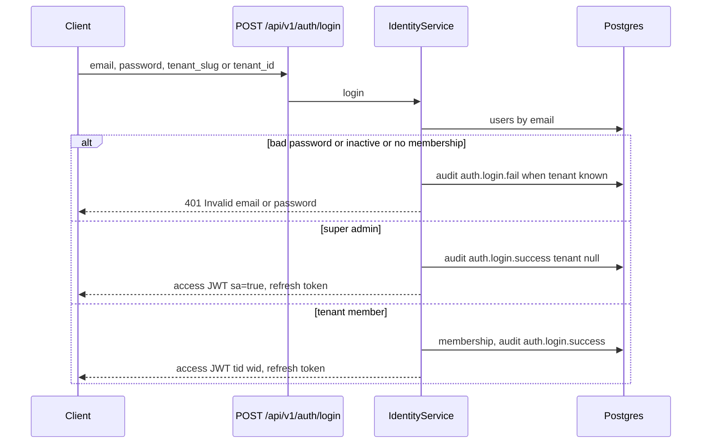
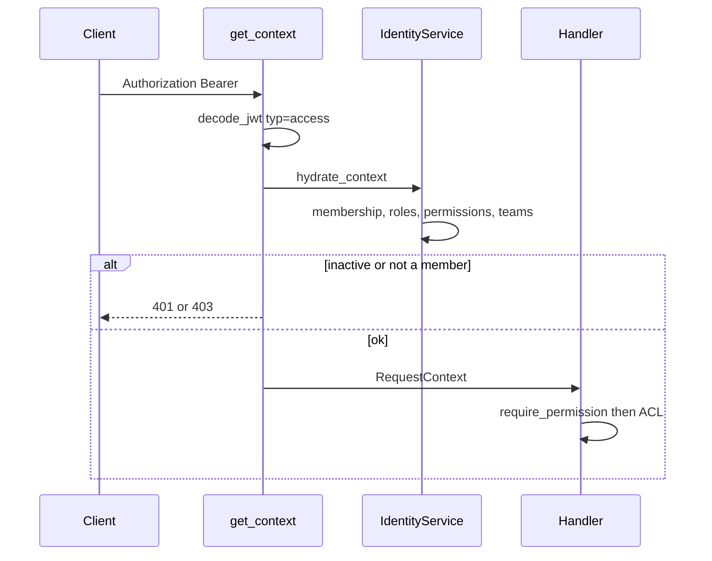
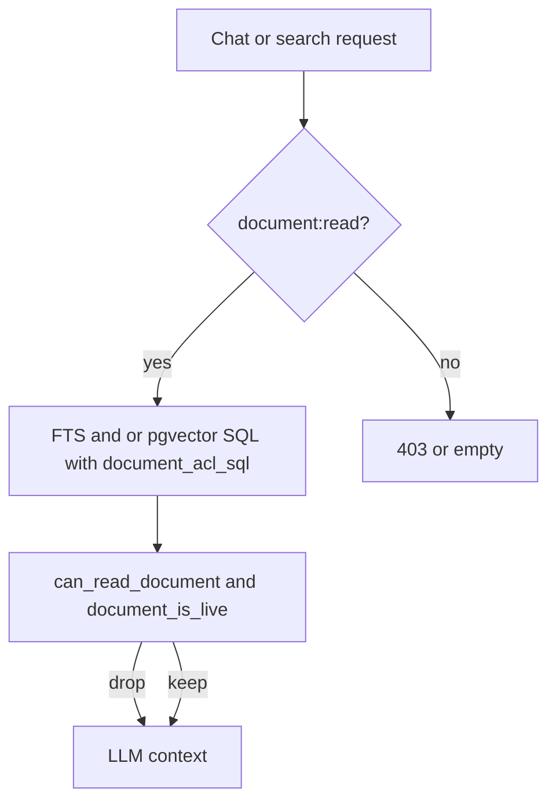

# Security architecture

Existing behavior unless marked otherwise.

## Authentication

### Passwords

`hash_password` / `verify_password` use Argon2 via `argon2.PasswordHasher` (`backend/app/core/security.py`). Signup, accept-invite, and reset require `password` length ≥ 10 (Pydantic `Field(min_length=10)` plus a service check on signup). Login failure and unknown email share the message `Invalid email or password` (`IdentityService.login`).

### Access token

`issue_jwt` signs HS256. Required claims on decode: `exp`, `sub`, `typ`. Expected type for API access is `access`.

| Claim | Meaning |
| --- | --- |
| `sub` | User id |
| `typ` | `access` |
| `tid` | Tenant id, omitted for super-admin sessions |
| `wid` | Default workspace id when present |
| `sa` | `true` only when the user is super admin and the session has no tenant |
| `jti`, `iat`, `exp` | Id and lifetime |

Default TTL: `auth.access_ttl_seconds` = 900 (`configs/base.yaml`). The JWT does **not** contain roles or permissions.

`get_claims` (`backend/app/api/deps.py`) requires `Authorization: Bearer`. Missing or wrong scheme → `UnauthenticatedError` (401). Invalid or expired token → 401 `Invalid or expired token`.

`get_context` then opens a DB session, applies RLS session variables, and calls `hydrate_context` or `hydrate_super_admin`. Disabled users, missing membership, and inactive tenants fail closed (401 or 403).

### Refresh token

`new_refresh_token` is `os.urandom(32).hex()`. Only `SHA-256` is stored on `refresh_tokens` (`hash_token`). Refresh looks up the hash, rejects missing, revoked, or expired rows, revokes the presented row, and issues a new pair (`IdentityService.refresh`). Logout sets `revoked_at` if the hash exists; unknown tokens still return `{"ok": true}` (`logout` route).

Refresh does not require the access token.

### Public signup

`POST /api/v1/auth/signup` calls `IdentityService.signup` only when `allow_public_signup()` is true (`RAG_ALLOW_PUBLIC_SIGNUP` in `1`, `true`, `yes`, `on`). Otherwise 403 `Public signup is disabled`. Production startup refuses to boot if that flag is set (`enforce_runtime_safety`).

Signup creates a user, a tenant, a default organization and workspace, seeded roles, a Tenant Admin `user_roles` row, and a membership, then returns tokens (`_create_tenant_graph`, `_issue_session`).

### Invites and password reset

`invitations.token_hash` is unique. Purpose distinguishes invite and reset (column `purpose`, default `invite`). `forgot_password` takes email and `tenant_slug`. `expose_dev_tokens` can include raw tokens in non-production responses (`backend/app/core/flags.py`). Production startup also rejects `EMAIL_PROVIDER=console` and localhost `PUBLIC_APP_URL`.

### Super admin seed

Lifespan calls `IdentityService.ensure_super_admin()`. Failures are swallowed. Environment variables `PLATFORM_SUPERADMIN_EMAIL` and `PLATFORM_SUPERADMIN_PASSWORD` are documented in `.env.example`. The seed function lives on `IdentityService` (around the `ensure_super_admin` method). Super admin is `users.is_super_admin`, not a tenant role (`rbac.py` comment).

### Session switch

`POST /api/v1/auth/switch-tenant` requires a valid access token. Super admin receives 403 `Super admin does not join customer tenants`. Others must have `tenant_memberships` for an active tenant.

## Authorization

Two layers. Both are required for document reads.

### Layer 1 — permission codes

`require_permission` / `require_any_permission` check `RequestContext.has`. `has` expands equivalents and grants (`backend/app/core/permissions.py`):

- `document:read` ≡ `documents.view`, and the reverse.
- `document:write` ≡ `documents.upload`, and `document:write` also grants `documents.update`, `documents.share`, `folders.create`, `folders.share`, `folders.update`.
- `document:delete` ≡ `documents.delete` and grants `folders.delete`.
- `user:manage` grants the `users.*` and `roles.*` codes.
- `config:write` / `config:read` grant tenant settings and AI configuration codes.
- `conversation:write` ≡ `ai.chat`.

Super admin `has()` returns true only for `PLATFORM_PERMISSIONS` or names starting with `platform.`. It does **not** imply `document:read` or `document:read_all`.

Denial writes an audit row `authz.denied` when the DB write succeeds. The audit helper swallows its own exceptions.

### Layer 2 — document ACL

`can_read_document` (`backend/app/application/authz.py`):

1. Caller must have `document:read` (after expansion).
2. `document:read_all` returns true immediately.
3. Empty or missing ACL returns false (fail closed), except read_all.
4. Deny lists (users, team names as groups, role names) win.
5. Allow if owner id matches, or `visibility == tenant`, or user/group/role is on the allow list.

`document_acl_sql` is the SQL form of that predicate. It is embedded in:

- `authorized_document_ids` (list, catalog)
- `PgVectorStore.search`
- `PostgresFTSIndex.search`
- `ChatService._intro_hits`

`ChatService._authorized_hits` and citation rendering call `can_read_document` again and drop documents that are not live (`document_is_live`) or whose source does not feed the index.

### Role seeds

`TENANT_ADMIN_PERMISSIONS` is every code in `ALL_PERMISSIONS` except `document:read_all` (`backend/app/application/rbac.py`). The comment states Tenant Admin follows document ACLs by default and `document:read_all` remains available for an explicit grant.

| Role | System? | Document-relevant permissions (not exhaustive) |
| --- | --- | --- |
| Tenant Admin | yes | `document:read`, `document:write`, `document:delete`, user/role/config/audit/source admin codes. Not `document:read_all` |
| Member | no | `document:read`, `document:write`, share/update, `source:manage`, `ai.chat`, conversation read/write/delete. Not delete-all documents (`document:delete` is absent) |
| Viewer | no | `document:read`, `conversation:read`, `documents.view`, `ai.chat`, `config:read` / `ai.configuration.view`. No write, no `source:manage` |

`document:write` on Tenant Admin expands to `documents.share` and folder mutate codes via `PERMISSION_GRANTS`.

Migration `009` deletes `document:read_all` from roles named `Tenant Admin` or `Admin`, and sets `documents.acl.visibility` to `tenant` for private documents owned by those role holders. It increments `tenants.authz_epoch`.

### Upload defaults

`default_upload_acl`:

- Always starts from `owner_acl`: `visibility: private`, `allowed_users: [owner]`.
- If `is_tenant_admin(ctx.role_names)`, visibility becomes `tenant`.

`resolve_upload_acl` applies when the client sends `visibility` and/or `allowed_roles`:

- `visibility` must be `private` or `tenant`.
- `allowed_roles` must be Member, Viewer, or Tenant Admin (`normalize_allowed_roles` maps `Admin` → `Tenant Admin`). Unknown names → 422.
- If roles are sent and visibility is omitted, visibility stays `private` (roles are the audience) unless the uploader is Tenant Admin and the role list is empty, in which case visibility is `tenant`.

`POST /api/v1/documents` form fields: `workspace_id`, `visibility`, `allowed_roles` (JSON array or comma-separated).

### Share

`POST /api/v1/documents/{id}/acl` requires `document:read`, then `can_share_document`: `source:admin`, or `document:write` and the caller is `owner_user_id` or `acl.owner_id`. Failure to share is `NotFoundError` (404), including when the document exists but the caller cannot share it. Successful share writes audit `document.share` and `persist_authz_bump` on the tenant epoch (invalidates chat cache keys).

Folder grants live in `resource_permissions` and are compiled into document ACL by `FolderService` (`backend/app/application/folders.py`). Folder HTTP routes authenticate with `get_context` only; permission checks are inside `FolderService` (`folders.create`, `folders.update`, `folders.delete`, `folders.share`, plus view rules).

### Connector ownership

`can_manage_source`: `source:admin`, or `source:manage` and `data_sources.owner_user_id` equals the caller. Scheduled sync rehydrates the source owner and skips the subscription if the owner is disabled or not a member (`run_due_syncs`).

### Jobs

`GET /api/v1/jobs` requires `job:read`. Without `document:read_all` or `source:admin`, a job is listed only when the caller can read its document or manage its source. Retry (`POST /jobs/{id}/retry`) uses the same visibility rule and requires `document:write` when the caller is not privileged.

## Authn flow

Subsequent calls:

## Authz flow for retrieval

`read_all` skips the ACL predicate when the permission is actually on the role. Tenant Admin seed does not include it.

## Tenant isolation

`apply_rls` sets transaction-local `app.tenant_id` and `app.user_id` (`set_config` third argument `true`). Migration `001` creates `app_security.current_tenant_id()` and, for each tenant table, `ENABLE` and `FORCE ROW LEVEL SECURITY` plus policy `tenant_isolation` `USING` and `WITH CHECK` `tenant_id = app_security.current_tenant_id()`.

Tables **without** that policy (looked up before a tenant is chosen, or global): `tenants`, `users`, `permissions`, `refresh_tokens`, `invitations` (invitations carry `tenant_id` but the model comment says RLS is not applied because lookup is by token hash), `rate_limit_buckets`. Migration `007` adjusts `audit_logs` policy to allow platform rows. Confirm the exact `audit_logs` policy in `007_saas_platform.py` before relying on cross-tenant audit reads; platform audit uses `IdentityService.list_platform_audit_logs` under `require_super_admin`.

**Superuser caveat.** PostgreSQL superusers bypass RLS, including `FORCE ROW LEVEL SECURITY`. Compose sets `POSTGRES_USER=rag`, which is a superuser. Application code still passes `tenant_id` in queries. RLS is defense in depth only when the connecting role is not a superuser and does not have `BYPASSRLS`.

`users` and `tenants` are not in `TENANT_TABLES`. Login queries them without a tenant GUC.

## Transport and browser

`SecurityHeadersMiddleware`: `X-Content-Type-Options: nosniff`, `X-Frame-Options: DENY`, `Referrer-Policy: no-referrer`, `Permissions-Policy` disabling camera/microphone/geolocation, `X-XSS-Protection: 0`, CSP `default-src 'self'; frame-ancestors 'none'; base-uri 'self'; form-action 'self'`. API paths get `Cache-Control: no-store`. Production adds HSTS `max-age=31536000; includeSubDomains`.

CORS: credentialed, methods GET/POST/PUT/PATCH/DELETE/OPTIONS, headers `Authorization`, `Content-Type`, `Accept`. Origins come from `http.cors_origins` with `*` stripped. Non-production adds regex `https?://(localhost|127\.0\.0\.1)(:\d+)?`.

Frontend stores `access_token` in `localStorage` (`frontend/src/api/client.ts`). Refresh handling is in that client. XSS can read the token. CSP is the API response policy; the Vite dev server is a different origin.

Rate limit: auth routes are IP-only; other routes are IP plus tenant id decoded from the bearer token when it verifies. Health and OPTIONS are excluded. Excess → 429 problem body `rate_limited`. The 429 from middleware does not include `request_id` (the middleware builds the JSON itself).

## Secrets and config denylist

`secret://env/NAME` is resolved by `backend/app/config/secrets.py` when `resolve=True`. `create_app` loads settings with `resolve=False`, so `secret://` strings can remain until a caller resolves them (JWT secret is resolved in `get_claims` via `resolve_jwt_secret`).

`assert_overlay_allowed` rejects tenant overlays that set `database.*`, `redis.*`, `http.*`, `auth.jwt_secret`, `auth.provider`, API keys, storage keys, or `email.*`. User and request scopes are allowlisted to a few retrieval/LLM numeric fields (`backend/app/config/merge.py`).

`GET /api/v1/config` redacts keys containing `secret`, `password`, `api_key`, or ending in `token`.

Connector tokens are stored in `connector_credentials.encrypted_access_token` / `encrypted_refresh_token`. Encryption helper: `backend/app/core/crypto.py` (used by the connector credential path).

## Prompt and citation controls

`generation.refuse_without_evidence` (default true) returns `refusal_message` when `_has_evidence` is false. With `reranker.provider: identity` (the development default), `_has_evidence` returns true whenever any reranked hit exists. It does **not** apply `minimum_relevance_score` (0.72) for the identity provider. Lexical reranker uses score ≥ 0.05. Other rerankers use `minimum_relevance_score`.

Citations attached to the answer are taken from the already filtered source list (`_citations_for` / `_validate_citations` in `chat.py`). Stored citations are filtered again when messages are read.

`backend/app/core/untrusted.py` `untrusted_text` is applied to document titles and message content in list/read APIs.

## Security-relevant error behavior

| Condition | HTTP | Code |
| --- | --- | --- |
| Missing/invalid access token | 401 | `unauthenticated` |
| Missing permission | 403 | `forbidden` |
| Document hidden by ACL on read/version routes | 404 | `not_found` |
| Share of a document the caller cannot manage | 404 | `not_found` |
| Validation | 422 | `validation_error` |
| Public signup disabled | 403 | `forbidden` |
| Rate limit | 429 | `rate_limited` |
| Ollama down during generation | 502 | `platform_error` |
| Unexpected exception | 500 | `platform_error` with detail `An unexpected error occurred` |

Problem JSON shape is in [API.md](API.md).
