# Sequence diagrams

Each diagram is a path that exists in this repository. Participants use the function or process that actually runs.

## Sequence diagram index

| # | Diagram | Represents |
| --- | --- | --- |
| 1 | Successful authenticated read | `GET /api/v1/documents` from bearer token through ACL SQL |
| 2 | Authentication | `POST /api/v1/auth/login` for a tenant member |
| 3 | Authorization denial | `require_permission` failure and audit |
| 4 | Document hidden by ACL | Version read returns 404 |
| 5 | Upload and ingest | `POST /api/v1/documents` including inline `process_job` |
| 6 | Chat / RAG | `POST /api/v1/chat` hybrid retrieval and Ollama |
| 7 | Database session | RLS GUCs inside `session.begin()` |
| 8 | External API | `OllamaLLM.stream` and `OllamaEmbedding.embed_documents` |
| 9 | Async / worker | Why the worker process does not run the job the API runs inline |
| 10 | Error | Ollama connection error on chat |
| 11 | Retry | `POST /api/v1/jobs/{job_id}/retry` |
| 12 | Timeout | Embedding httpx timeout inside `process_job` |
| 13 | Scheduled sync | `scheduler_loop` → `ConnectorService.sync` |

## 1. Successful authenticated read

`list_documents` in `backend/app/api/v1/documents.py`, `authorized_document_ids` in `authz.py`.

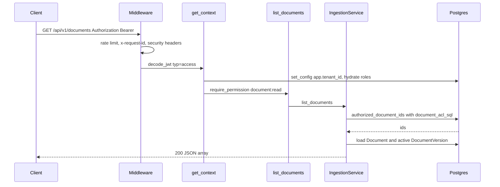

## 2. Authentication

`IdentityService.login`.

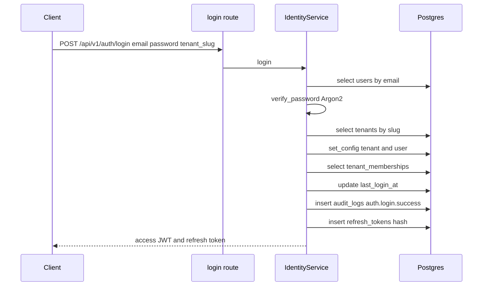

## 3. Authorization denial

`require_permission` in `backend/app/api/deps.py`.

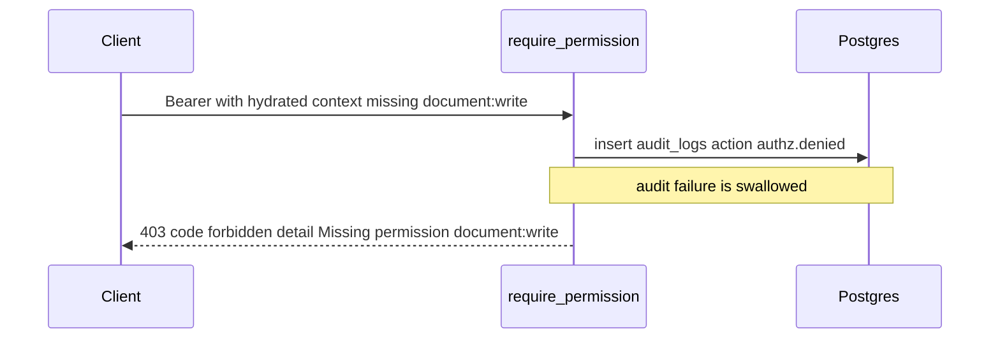

## 4. Document hidden by ACL

`IngestionService.list_versions` calls `_visible` → `can_read_document`. SQL list uses the same predicate. A viewer who is not allowed receives 404, including when the UUID exists.

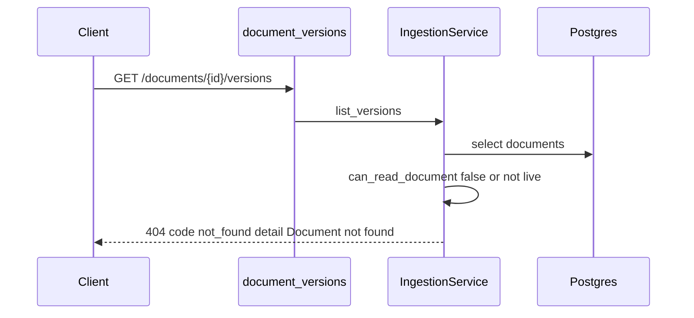

## 5. Upload and ingest

`upload_document` then `IngestionService.process_job`. Queue provider `asyncio` (development) or `taskiq_redis`.

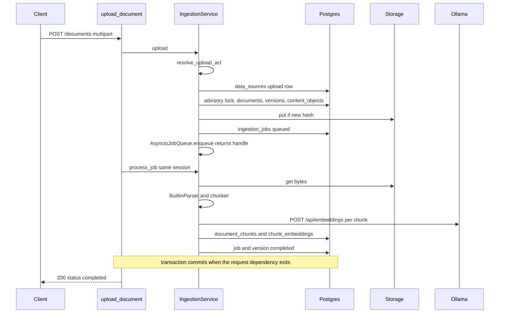

## 6. Chat / RAG

`ChatService.ask` with development settings: hybrid, identity reranker, Ollama.

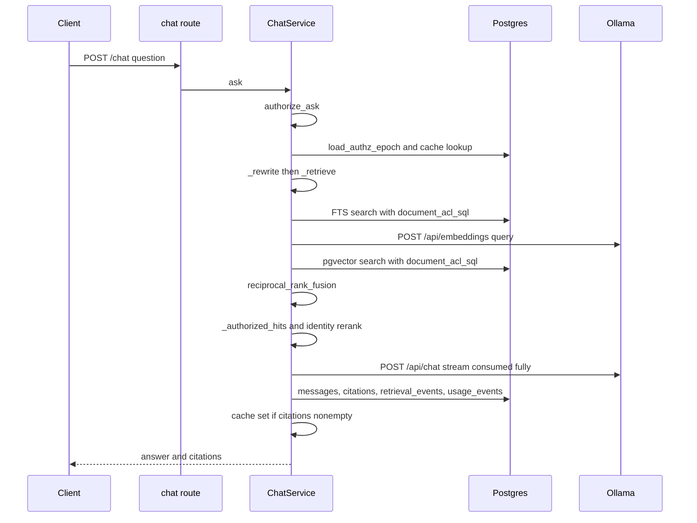

## 7. Database interaction

`_db` dependencies and `apply_rls`.

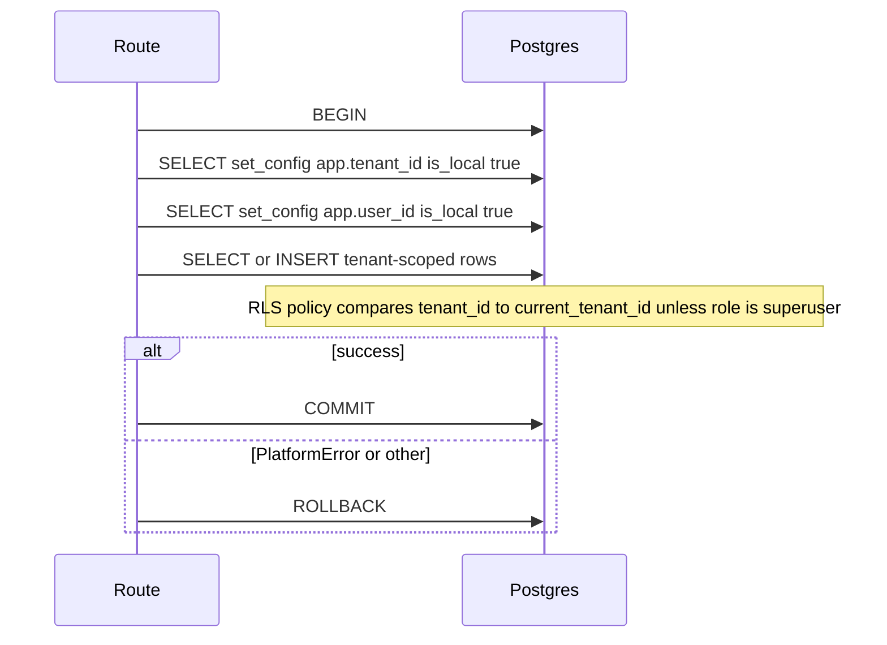

`process_job` adds `SAVEPOINT` via `begin_nested()` around chunk writes.

## 8. External API (Ollama)

`OllamaLLM.stream` timeout 120s. `OllamaEmbedding` uses base `http://127.0.0.1:11434` regardless of `llm.api_base`.

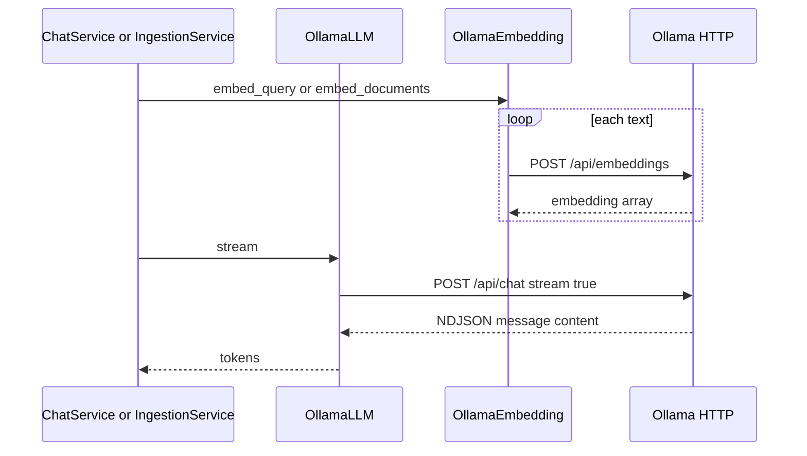

Health uses a different call: `GET /api/tags` with timeout 2s (`backend/app/api/v1/health.py`).

## 9. Async / worker

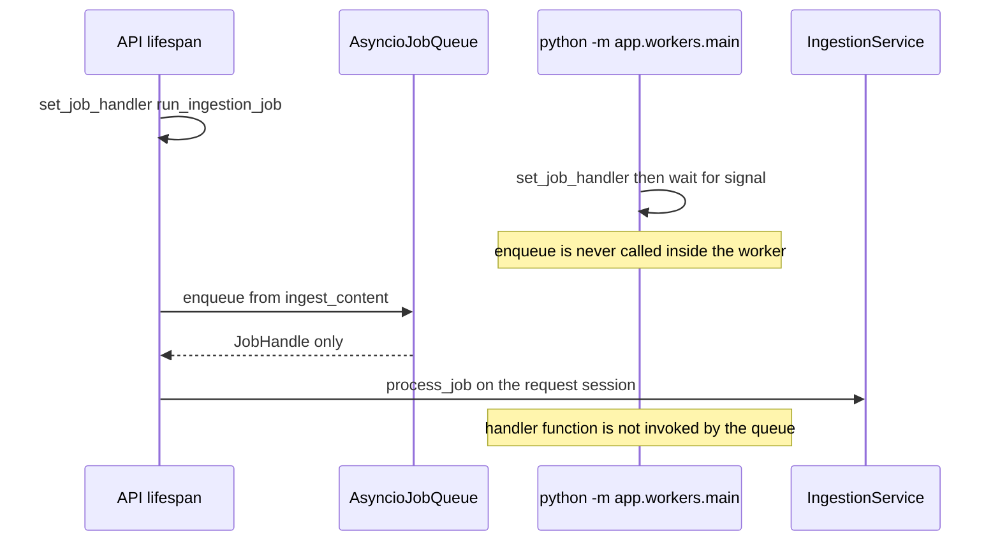

## 10. Error (Ollama down during chat)

`OllamaLLM.stream` raises `PlatformError` status 502. `ask` does not catch it. The global handler returns the problem body. `stream_ask` catches `PlatformError` and yields an SSE error instead.

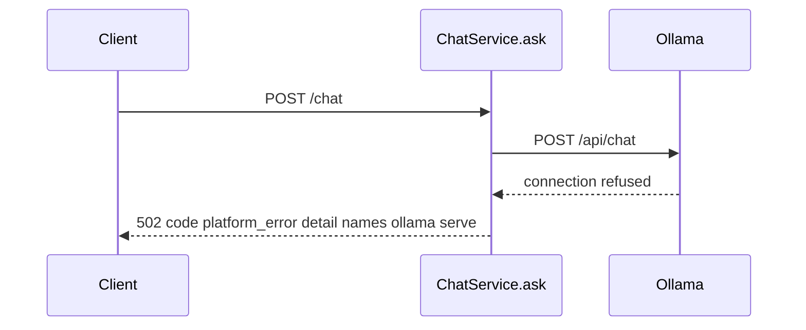

## 11. Retry

`retry_job` in `backend/app/api/v1/admin.py` calls `run_ingestion_job`, which opens a new transaction and calls `process_job`. `attempts` increments again. The third failed attempt sets `dead_letter`.

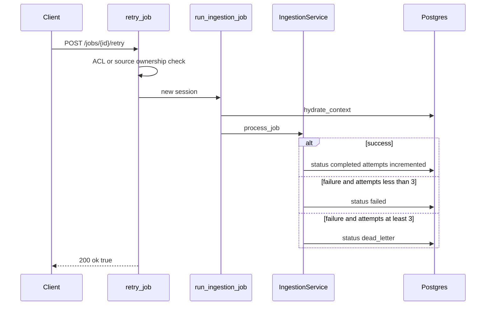

The HTTP response is `ok: true` even when `process_job` caught an error and stored `failed`. The client must `GET /jobs` to see status. `run_ingestion_job` also swallows unexpected exceptions after logging `ingestion_job_failed`.

## 12. Timeout during ingest

httpx client timeout is 120 seconds. There is no separate application timeout.

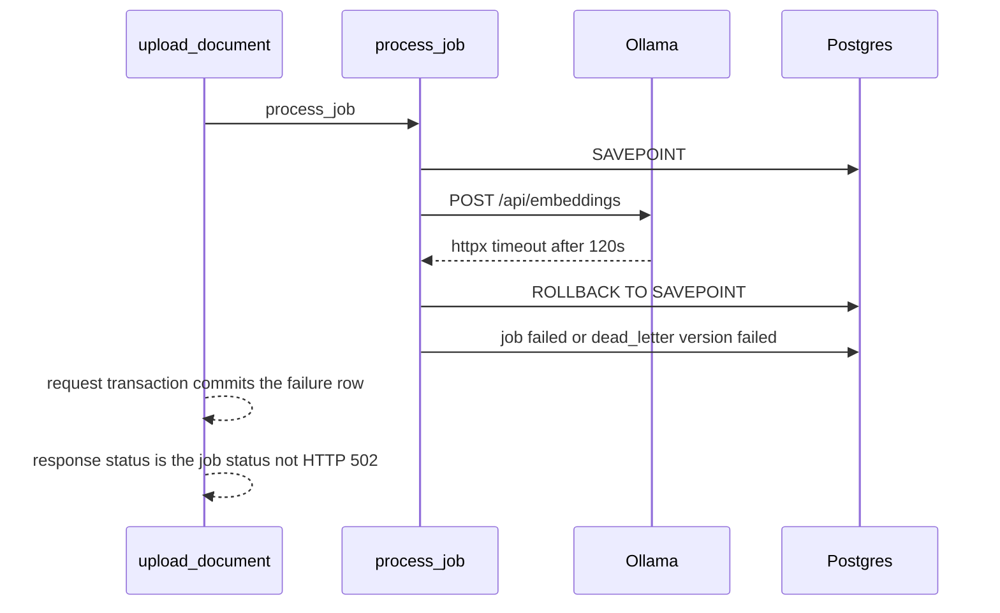

Upload maps the failure into the JSON `status` / `error` fields because `process_job` does not re-raise. Chat does not use that catch.

## 13. Scheduled sync

`scheduler_loop` waits 60 seconds or until shutdown. `run_due_syncs` is not started in the worker module.

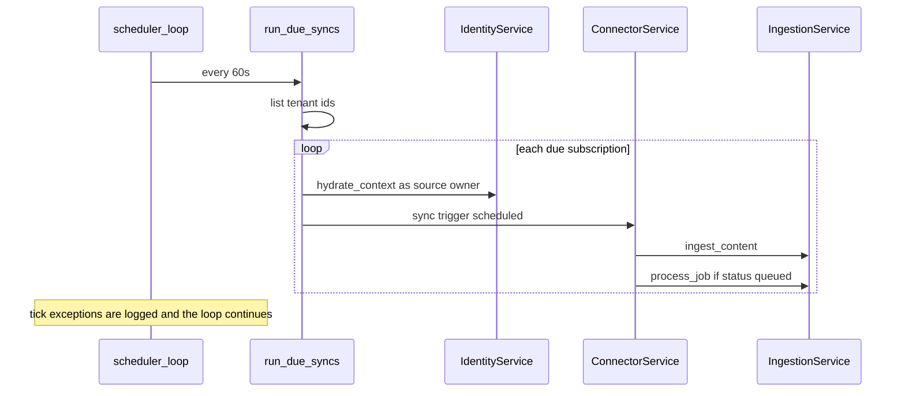

On sync failure, `next_sync_at` stays in the past, so the next tick can select the same subscription again.
